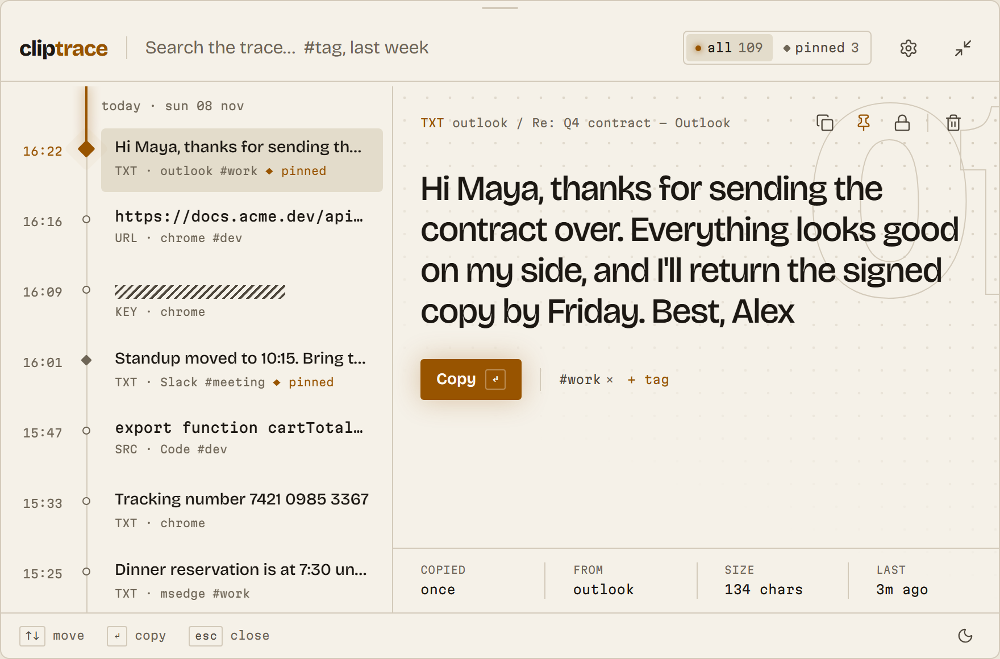
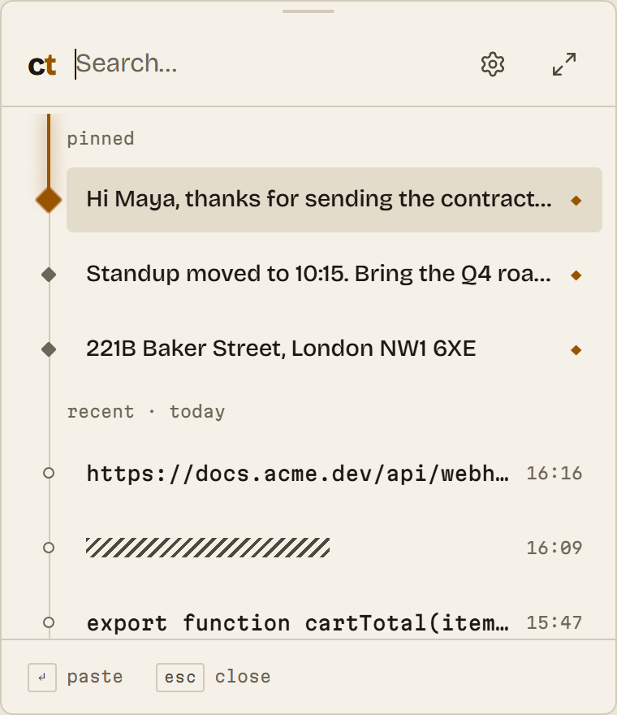
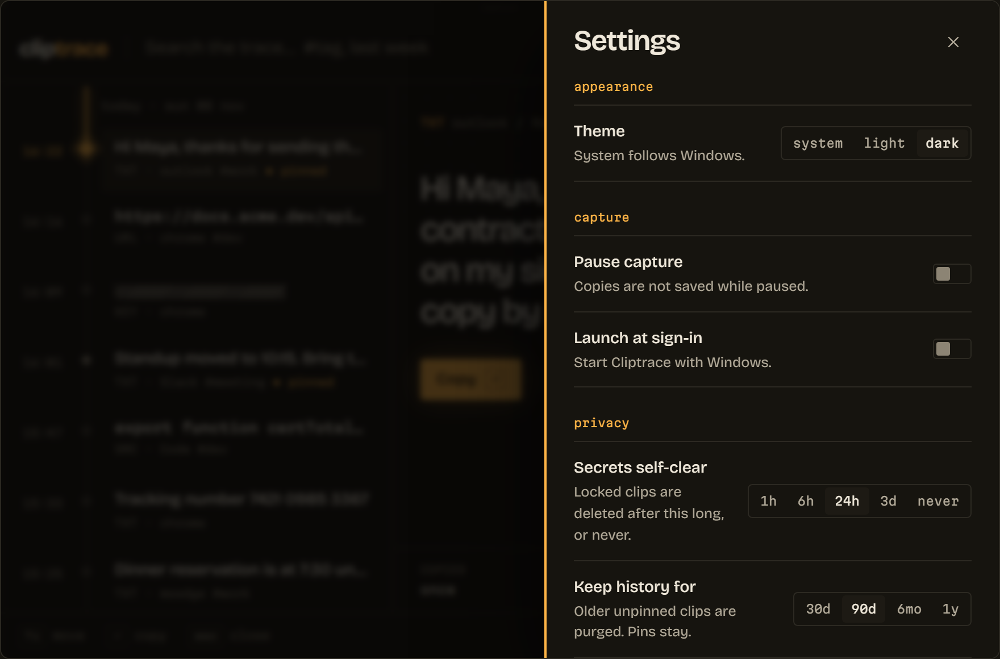
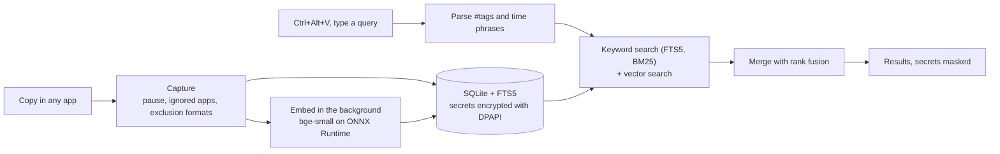

<p align="center">
  
</p>

# Cliptrace

[](https://github.com/Ekpo-Emmanuel/cliptrace/actions/workflows/ci.yml)
[](LICENSE)
[](https://github.com/Ekpo-Emmanuel/cliptrace/releases/latest)

A clipboard history for Windows that lives on your PC and searches by meaning. Every text you copy is saved and indexed on your machine, so you can type "that Stripe key thing from Tuesday" and get it back.

Nothing leaves your PC. The only network call is a one-time download of the search model on first run.

<p align="center">
  <picture>
    <source media="(prefers-color-scheme: dark)" srcset="docs/images/full-dark.png">
    
  </picture>
</p>

<p align="center"><sub>The full view. Sample clips shown.</sub></p>

## Features

- Captures every text copy, with the source app and window title.
- Searches by meaning and keywords together, and understands time phrases such as `yesterday`, `last week` or `3 days ago`.
- Keeps secrets safe. Copies from password managers are skipped. Secret-shaped text (API keys, tokens, private keys) is encrypted with Windows DPAPI, shown masked, and kept out of the search indexes.
- Pin clips so they never expire. Tag clips and filter with `#tag`.
- Two views: a full view (880×580) with a preview pane, and a narrow Quick paste view (380×440).
- Light and dark themes.
- Pause capture, ignore apps, and choose how long history and secrets are kept.

## Install

1. Download `Cliptrace_<version>_x64-setup.exe` from the [latest release](https://github.com/Ekpo-Emmanuel/cliptrace/releases/latest) and run it. It installs for your user only and does not ask for administrator rights during setup.
2. Start Cliptrace from the Start menu.
3. Press `Ctrl+Alt+V` to open the popup.

If you prefer no installer, download `Cliptrace-<version>-win64.zip` instead and unzip it anywhere. Run `cliptrace-app.exe` as administrator, and keep `onnxruntime.dll` and `onnxruntime_providers_shared.dll` in the same folder.

The first launch downloads the search model once, so it needs an internet connection. After that Cliptrace works offline. Until the model is ready, and if the ONNX Runtime files are missing, search falls back to keywords only. Settings → About shows whether search is `hybrid` or `keyword-only`.

The app is not code signed yet, so Windows SmartScreen may warn about an unknown publisher. Choose "More info", then "Run anyway".

Requirements: Windows 10 or 11 with WebView2 (included in Windows 11).

## Using it

Cliptrace runs in the system tray. Press `Ctrl+Alt+V` from any app to open the popup, type to search, and press `Enter` to copy the selected clip. Clicking a clip copies it too. In Quick paste the popup then closes. In full view it stays open.

<p align="center">
  <picture>
    <source media="(prefers-color-scheme: dark)" srcset="docs/images/quick-paste-dark.png">
    
  </picture>
</p>

<p align="center"><sub>Quick paste, opened with <code>Tab</code>. Pinned clips come first.</sub></p>

Search tips:

- Plain words search by meaning: `stripe key`.
- Add a time phrase: `invoice last week`, `meeting notes yesterday`.
- Filter by tag with `#`: `#work`.

### Keyboard shortcuts

| Keys | Action |
|---|---|
| `↑` `↓` | Previous or next clip |
| `PgUp` `PgDn` | Jump six clips |
| `Home` `End` | First or last clip (empty search) |
| `Ctrl+1` `Ctrl+2` | All clips or pinned clips |
| `Ctrl+K` | Focus search |
| `Enter` | Copy and close |
| `Ctrl+P` | Pin or unpin |
| `Ctrl+T` | Add a tag |
| `Ctrl+L` | Mark as secret |
| `Del` | Delete (undo with `Ctrl+Z`) |
| `Shift+↑` `Shift+↓` | Extend the selection |
| `Ctrl+Space` | Check or uncheck a clip |
| `Ctrl+A` | Check all clips (empty search) |
| `Tab` | Switch between full view and Quick paste |
| `Ctrl+,` | Settings |
| `Ctrl+Shift+D` | Switch between light and dark |
| `Esc` | Close or step back |

### Settings

Open Settings with the gear button or `Ctrl+,`.

<p align="center">
  
</p>

- **Theme:** system, light or dark.
- **Pause capture:** stop saving copies until you turn it back on.
- **Launch at sign-in:** start Cliptrace with Windows.
- **Secrets self-clear:** delete secrets after 1 hour, 6 hours, 24 hours, 3 days, or never.
- **Keep history for:** 30 days, 90 days, 6 months or 1 year. Pinned clips stay.
- **Ignored apps:** copies from these apps are never saved. Add the exact executable name, for example `notepad.exe`.

The hotkey is changed in `config.toml` (see below).

## Your data

Everything is stored under `%LOCALAPPDATA%\Cliptrace\`. Set the `CLIPTRACE_DATA_DIR` environment variable to use another folder.

| Path | Contents |
|---|---|
| `cliptrace.db` | Your clip history (SQLite) |
| `config.toml` | Blocklist, retention, hotkey, ONNX Runtime path |
| `models\` | The downloaded search model |
| `runtime\` | Optional place for `onnxruntime.dll` |

Cliptrace looks for `onnxruntime.dll` in the path set in `config.toml`, then next to the exe, then in `runtime\`.

## Privacy

- No telemetry, no cloud, no sync.
- Logs never contain clip content.
- Clipboard exclusion formats and the ignored-apps list are checked before any text is read.
- Raw secret values are never stored in plain text, in the search index, or in the vector index. The UI shows masked previews only.
- Ordinary clips are stored as plain text in the database. Only detected or manually marked secrets are encrypted, so treat `cliptrace.db` as private.

## How it works

Cliptrace is one Windows process: a Rust core library, a small Tauri shell (tray, global hotkey, popup window), and a React and TypeScript interface that talks to Rust through typed commands. There is no server and no account.



- **Capture** listens for clipboard changes with a hidden Win32 window, without polling. Pause and the ignored-apps list are checked before the clipboard is opened, and the clipboard exclusion formats that password managers set are checked before any text is read.
- **Search** splits a query into `#tags`, a time phrase (`last week`) and the remaining words. Those words go to SQLite FTS5 with BM25 ranking and, as a 384-dimension vector from the `bge-small-en-v1.5` model, to a similarity search. Reciprocal Rank Fusion (k = 60) merges the two rankings. If the model is unavailable, search falls back to keywords only.
- **Secrets** are detected by known key formats and an entropy rule. A matching clip is encrypted with Windows DPAPI, stored with no plain text, and indexed only by a context sentence such as `stripe key copied from chrome.exe`.

The full technical documentation, with sequence diagrams, the database schema, design decisions and known weaknesses, is in [docs/PROJECT_DOCUMENTATION.md](docs/PROJECT_DOCUMENTATION.md).

## Performance

Search was measured on synthetic data with a script you can run yourself:

```bash
cargo run --release -p cliptrace-core --example bench_search
```

Hybrid search (keyword, vector and rank fusion) over a growing history, from three runs on one Windows PC:

| Stored clips | Hybrid search |
|---|---|
| 1,000 | about 20 to 30 ms |
| 10,000 | about 190 to 250 ms |
| 50,000 | about 0.9 to 1.0 s |
| 100,000 | about 1.8 to 3.6 s |

The vector search is a brute-force scan, so its cost grows in proportion to the number of clips. Typical clipboard histories are far smaller than 100,000 items, but this is the main scaling limit and [issue #6](https://github.com/Ekpo-Emmanuel/cliptrace/issues/6) tracks the fix. The numbers vary by 30 to 50% between runs, use made-up text with a small vocabulary (so keyword numbers are pessimistic), and leave out the time to embed the query with the model.

## Known limitations and roadmap

Cliptrace handles text only: no images or files. The search model is English, and the app is Windows only and not yet code signed. These are the engineering issues I know about, with evidence in each:

- [#5](https://github.com/Ekpo-Emmanuel/cliptrace/issues/5) Tagging a clip deletes its vector and the desktop app never recomputes it (bug)
- [#6](https://github.com/Ekpo-Emmanuel/cliptrace/issues/6) Vector search reads every embedding and each clip's full text per query
- [#7](https://github.com/Ekpo-Emmanuel/cliptrace/issues/7) Reuse one database connection instead of reopening it for every command
- [#8](https://github.com/Ekpo-Emmanuel/cliptrace/issues/8) Deleting a clip rebuilds the whole full-text index and runs `VACUUM`
- [#9](https://github.com/Ekpo-Emmanuel/cliptrace/issues/9) The code assumes WAL mode but never enables it
- [#10](https://github.com/Ekpo-Emmanuel/cliptrace/issues/10) Add UI tests
- [#11](https://github.com/Ekpo-Emmanuel/cliptrace/issues/11) An unsalted SHA-256 of the text is stored, including for secrets
- [#12](https://github.com/Ekpo-Emmanuel/cliptrace/issues/12) The `#tag` filter matches by substring (bug)

## Build from source

Needs Rust (stable), Node.js, and the WebView2 runtime. You also need the official ONNX Runtime CPU `onnxruntime.dll` (and `onnxruntime_providers_shared.dll`) for hybrid search.

Run the core tests:

```bash
cargo test -p cliptrace-core
```

Run the UI in a browser with mock data:

```bash
npm --prefix ui run dev
```

Run the desktop app in development, with the Vite dev server running:

```bash
cd src-tauri
cargo run
```

Build a release exe that serves the bundled UI:

```bash
npm --prefix ui run build
cd src-tauri
cargo build --release --features custom-protocol
```

The exe is `target\release\cliptrace-app.exe`. Without the `custom-protocol` feature it loads the dev server URL instead of the bundled UI.

To build the installer, first copy `onnxruntime.dll`, `onnxruntime_providers_shared.dll` and `LICENSE-onnxruntime.txt` into `src-tauri\runtime\` (that folder is git-ignored). Then run, from the `src-tauri` folder:

```bash
../ui/node_modules/.bin/tauri build
```

The installer is written to `target\release\bundle\nsis\`.

### Command line

A CLI exists for development and scripting.

```bash
cargo run -p cliptrace-cli -- watch
cargo run -p cliptrace-cli -- search "stripe key from tuesday"
cargo run -p cliptrace-cli -- list --limit 20
```

Run it with no arguments to see all commands, including `pin`, `tag`, `copy`, `purge`, `backfill`, `autostart` and `no-autostart`.

### Layout

- `crates/cliptrace-core`: capture, store, embeddings, search, time parsing, secrets, config.
- `crates/cliptrace-cli`: the command-line tool.
- `src-tauri`: the tray, hotkey, popup window and Tauri commands.
- `ui/`: the React, TypeScript and Tailwind interface.
- `design/v2/`: the design reference and screens.
- `landing/`: the landing page, a static site deployed on Vercel with the project's root directory set to `landing`.
- `docs/`: [PROJECT_DOCUMENTATION.md](docs/PROJECT_DOCUMENTATION.md), the code signing plan, and README images.
- `branding/`: the logo and the script that renders the app icons.
- `.github/workflows/`: `ci.yml` (tests and UI build on every pull request) and `release.yml` (manual release build, prepared for code signing).
- `SPEC.md`: the original design spec and milestones. It is partly out of date; the code and `docs/PROJECT_DOCUMENTATION.md` describe the current behavior.

## How this was built

Cliptrace was built with AI coding assistants (Cursor and Claude Code). The author set the requirements, tested the builds on real Windows PCs and decided what to ship. The rules the assistant was given are in [CLAUDE.md](CLAUDE.md). Mistakes found along the way are fixed in the open history, for example the installer icon fix in release 0.4.1.

## License

Cliptrace is released under the [MIT License](LICENSE).

## Third-party software

Cliptrace uses [ONNX Runtime](https://github.com/microsoft/onnxruntime) (MIT license) and the `bge-small-en-v1.5` embedding model through `fastembed`. The release zip includes the ONNX Runtime license.
