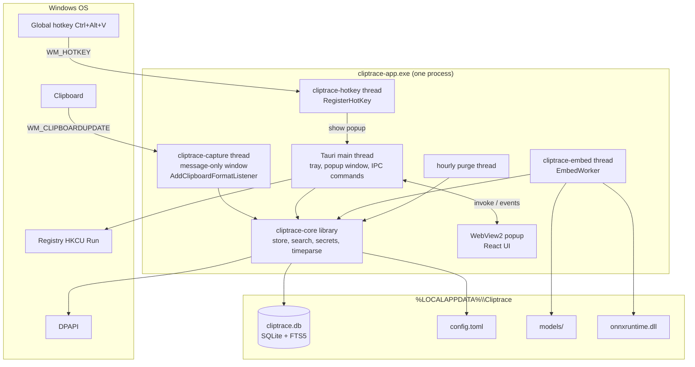
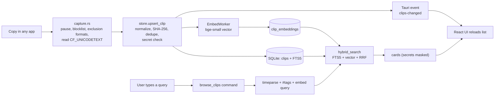
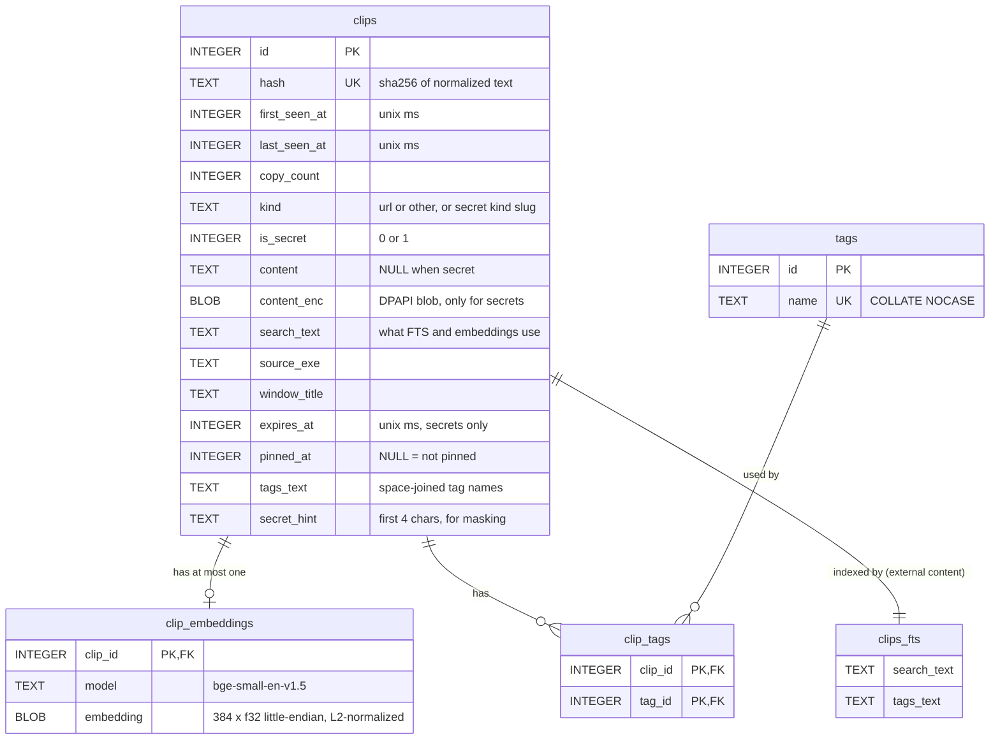
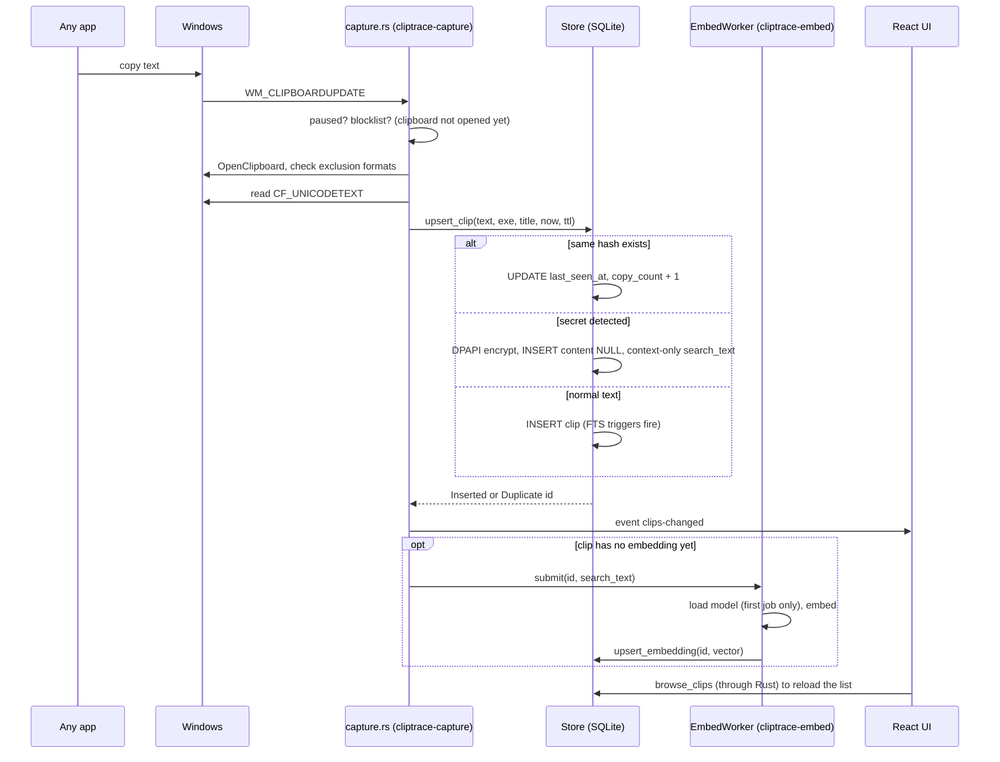
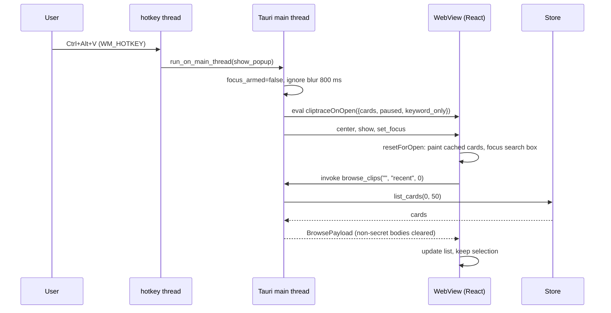
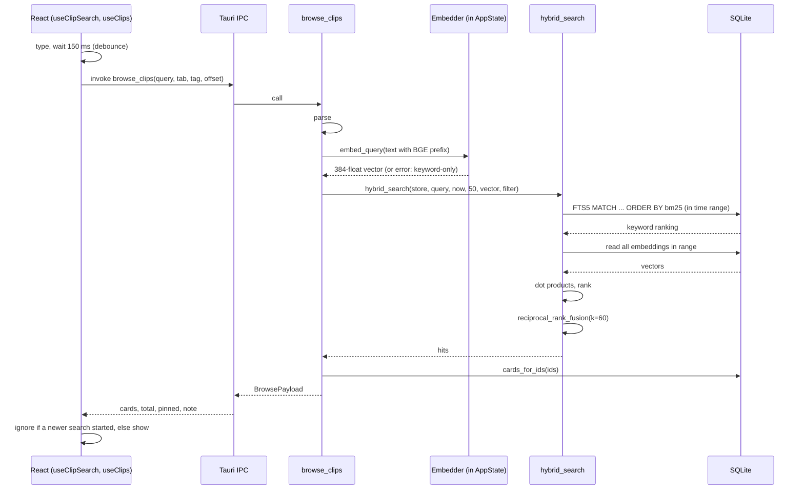
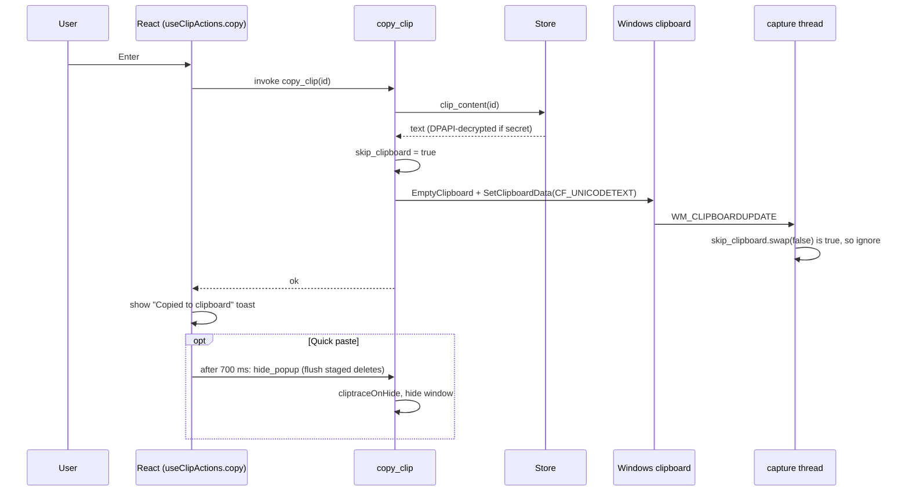
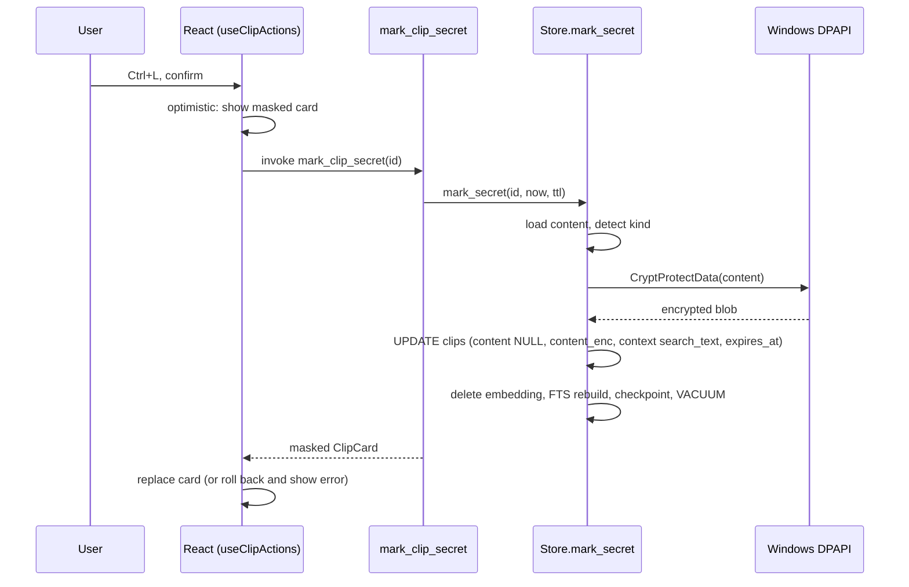

# Cliptrace: Project Documentation

> **Status of this document.** It describes Cliptrace **version 0.4.1** as the code stands on 2026-11-09. Every statement was checked against the source. Where `SPEC.md` (the original design document) and the code disagree, **the code wins** and the difference is called out. Anything that is missing, partial, or that I could not verify is marked **Not implemented**, **Unverified**, or **Known gap**. The main known gaps are tracked as [GitHub issues #5 to #12](https://github.com/Ekpo-Emmanuel/cliptrace/issues).
>
> **How to use it.** This document explains how Cliptrace works for a developer who has not seen the project. Read sections 1 to 3 once. Keep sections 4 to 8 open next to the code when you change something. Section 11 traces the main flows end to end, and section 12 lists the known weaknesses and the planned fixes.

## Contents

1. [Project Overview](#1-project-overview)
2. [How the App Works](#2-how-the-app-works)
3. [Project Structure](#3-project-structure)
4. [Frontend Documentation](#4-frontend-documentation)
5. [Backend Documentation](#5-backend-documentation)
6. [Database Documentation](#6-database-documentation)
7. [Authentication and Security](#7-authentication-and-security)
8. [External Services and Integrations](#8-external-services-and-integrations)
9. [Environment Variables and Configuration](#9-environment-variables-and-configuration)
10. [Key Decisions and Tradeoffs](#10-key-decisions-and-tradeoffs)
11. [Data Flow Examples](#11-data-flow-examples)
12. [Potential Weaknesses and Improvements](#12-potential-weaknesses-and-improvements)
13. [How to Run, Test, and Deploy](#13-how-to-run-test-and-deploy)
14. [Glossary](#14-glossary)

---

## 1. Project Overview

### What the app does

Cliptrace is a **local-only clipboard history for Windows 10 and 11 with search by meaning**. It runs in the system tray, listens for every text copy on the PC, stores each copy in a local SQLite database, and lets you press `Ctrl+Alt+V` to open a popup where you search the history and copy a clip back with Enter.

"Search by meaning" means a query like `invoice last week` or `the address from that email` finds a clip even when the clip does not contain those exact words. It does this by combining keyword search (SQLite FTS5) with vector similarity (a small embedding model run locally through ONNX Runtime) and by understanding time phrases such as `yesterday`, `last week` or `3 days ago`.

### The problem it solves

- The built-in Windows clipboard history (`Win+V`) keeps a small number of items and has no real search.
- People copy snippets, links, keys and addresses all day and later remember only what a clip was *about*, not what it said.
- Cloud clipboard tools solve this by uploading everything you copy, which is unacceptable for passwords, API keys and private text.

Cliptrace keeps everything on the PC, treats secrets specially, and makes the history searchable by description.

### Target users

Developers, support staff, writers and anyone who copies many small pieces of text each day and wants them back later without sending them to a cloud service.

### Core features (all implemented in the code)

| Feature | Where it lives |
|---|---|
| Capture every Unicode text copy with source app and window title | `crates/cliptrace-core/src/capture.rs` |
| Skip password managers and any app on a blocklist, before reading the clipboard | `capture.rs` (`capture_once`, `clipboard_excluded`) |
| De-duplicate identical copies (bump a counter instead of inserting) | `store.rs` (`upsert_clip`) |
| Hybrid search: FTS5 keywords + vector similarity, merged by Reciprocal Rank Fusion | `hybrid.rs`, `rrf.rs`, `store.rs` |
| Time phrases in queries | `timeparse.rs` |
| `#tag` filters in queries | `tags.rs` |
| Secret detection, DPAPI encryption, masked previews, self-clearing secrets | `secrets.rs`, `store.rs` |
| Pin clips (never expire), tag clips, mark a clip as a secret, delete with 5-second undo | `store.rs`, `ui/src/hooks/useClipActions.ts` |
| Per-type previews: link, email, phone, color, path, JSON, number, code, text | `kinds.rs`, `ui/src/components/ClipContent.tsx` |
| Two window modes (Full view 880x580, Quick paste 380x440) in light and dark themes | `src-tauri/src/main.rs`, `ui/src` |
| Settings: pause capture, ignored apps, secret self-clear time, history length, launch at sign-in | `ui/src/components/SettingsPanel.tsx`, `update_settings` command |
| First-run welcome screen | `ui/src/components/Welcome.tsx`, `open_welcome_on_first_run` |
| Command-line tool for the same operations | `crates/cliptrace-cli` |

Not implemented (deliberately out of scope for v1, per `SPEC.md`): image or file clips, rich text, cross-device sync, macOS or Linux, telemetry.

### Tech stack

| Layer | Technology | Version (from the manifests) |
|---|---|---|
| Language (backend) | Rust, edition 2024 | stable toolchain |
| Desktop shell | Tauri 2 (tray, popup window, IPC) | `tauri = "2"`, lock file pins 2.12.5 |
| Windows APIs | `windows` crate | 0.58 |
| Database | SQLite via `rusqlite` with the bundled SQLite, FTS5 | rusqlite 0.32 |
| Embeddings | `fastembed` with model `bge-small-en-v1.5` (384 dimensions), ONNX Runtime loaded dynamically | fastembed 5 |
| Time handling | `chrono` plus a hand-written parser | chrono 0.4 |
| Hashing | `sha2` (SHA-256) | 0.10 |
| Config | `toml` + `serde`, paths via `dirs` | toml 0.8, dirs 5 |
| Errors | `thiserror` in the library, `anyhow` in binaries | thiserror 2, anyhow 1 |
| Frontend | React 19, TypeScript 5.9, Vite 7, Tailwind CSS 4, `lucide-react` icons | `ui/package.json` |
| Installer | NSIS through the Tauri bundler, per-user install | `src-tauri/tauri.conf.json` |
| Landing page | Static site on Vercel, uses a design-tool runtime ("DC") | `landing/` |
| CI / release | GitHub Actions workflow, run by hand | `.github/workflows/release.yml` |

### High-level architecture

Cliptrace is **one process** (`cliptrace-app.exe`) that hosts several threads, plus an embedded WebView2 window for the UI. There is **no server, no network API and no account system**. The "backend" is Rust code in the same process; the "API" is a set of Tauri IPC commands.



The same `cliptrace-core` library is also used by a separate command-line binary (`cliptrace-cli`), which does not run the UI.

---

## 2. How the App Works

### The user journey, start to finish

1. **Install.** The user runs the NSIS installer (`Cliptrace_<version>_x64-setup.exe`). It installs for the current user only (`installMode: currentUser`). I did not check the default install folder; my installer test used a custom one. It puts `cliptrace-app.exe`, the two ONNX Runtime DLLs and the license files next to each other.
2. **First launch.** `main()` in `src-tauri/src/main.rs` takes a named mutex (`Local\CliptraceSingleInstance`) so only one copy runs. Then `setup` starts the capture thread, builds the tray icon, starts the hotkey thread, starts a delayed model warm-up, and calls `open_welcome_on_first_run`.
3. **Welcome.** If `config.toml` says `welcome_seen = false` (a new install, or an older config file without the key), the app waits 1.5 seconds and shows the popup. The UI sees `welcomed: false` in `get_settings` and shows the welcome screen until the user presses Enter, Esc or "Got it". That writes `welcome_seen = true`.
4. **Copying.** From then on, every copy in any app raises `WM_CLIPBOARDUPDATE` on a hidden message-only window. The capture code checks pause and blocklist, opens the clipboard, rejects clipboard-excluded content, reads `CF_UNICODETEXT`, and hands a `ClipEvent` to the store.
5. **Storing.** The store normalizes the text, hashes it, and either bumps an existing row or inserts a new one. Secret-looking text is encrypted with DPAPI instead of stored in plain text. The embed worker computes a vector in the background.
6. **Opening the popup.** `Ctrl+Alt+V` (or the tray's "Open") calls `show_popup`. The Rust side pushes a cached list of the 50 most recent clips into the page through `window.cliptraceOnOpen(...)`, so the list paints immediately. The UI then reloads fresh data.
7. **Searching.** Typing in the box (debounced by 150 ms) calls the `browse_clips` command. Rust parses `#tags` and time phrases, embeds the remaining words, runs keyword and vector search, fuses the rankings and returns cards.
8. **Pasting back.** Enter or a click calls `copy_clip`. Rust decrypts if needed, writes the text to the clipboard, and sets a flag so the capture thread ignores that one self-made copy. In Quick paste mode the popup then hides after 700 ms; in Full view it stays open.
9. **Housekeeping.** Pin, tag, mark as secret and delete all go through commands. Deleting is staged for 5 seconds so it can be undone. A purge job runs at start and every hour: it removes expired secrets and clips older than the retention period (pinned clips are kept).

### Data flow through the system



### Request lifecycle for the most important actions

The detailed, step-by-step traces with sequence diagrams are in [section 11](#11-data-flow-examples). In short:

| Action | Entry point | Main functions |
|---|---|---|
| A copy is captured | `WM_CLIPBOARDUPDATE` | `capture::wnd_proc` -> `capture_once` -> `Store::upsert_clip` -> `EmbedWorker::submit` |
| The popup opens | `WM_HOTKEY` | `spawn_hotkey_thread` -> `show_popup` -> `window.cliptraceOnOpen` |
| A search | typing in the box | `useClipSearch.search` -> `api.browseClips` -> `browse_clips` -> `hybrid_search` |
| Copy back | Enter or click | `useClipActions.copy` -> `copy_clip` -> `Store::clip_content` -> `set_clipboard_text` |
| Mark as secret | `Ctrl+L` then Enter | `askSecret` -> `confirmSecret` -> `mark_clip_secret` -> `Store::mark_secret` |
| Delete with undo | `Del` | `askDelete` -> `stage_delete`, then `delete_clip` after 5 s |

---

## 3. Project Structure

```
cliptrace/
├─ Cargo.toml                  Rust workspace: core, cli, src-tauri
├─ Cargo.lock
├─ CLAUDE.md                   Rules for the AI assistant working on the repo (process, privacy, UI rules)
├─ SPEC.md                     Original design spec and milestones M1 to M8b (partly out of date; see section 10)
├─ README.md                   User documentation
├─ LICENSE                     MIT
├─ crates/
│  ├─ cliptrace-core/          LIBRARY: all business logic
│  │  └─ src/
│  │     ├─ lib.rs             Module list and public re-exports
│  │     ├─ capture.rs         Win32 clipboard listener and writer
│  │     ├─ store.rs           SQLite schema, migrations, CRUD, search queries, purge, secrets at rest
│  │     ├─ search.rs          FTS query building, stopwords, time formatting
│  │     ├─ timeparse.rs       "yesterday", "last week", "3 days ago" -> a time range
│  │     ├─ tags.rs            Tag rules, #tag parsing, BrowseFilter
│  │     ├─ rrf.rs             Reciprocal Rank Fusion
│  │     ├─ hybrid.rs          The hybrid search pipeline
│  │     ├─ embed.rs           fastembed model loading, background EmbedWorker (feature "embeddings")
│  │     ├─ secrets.rs         Secret detection, masking, DPAPI encrypt/decrypt
│  │     ├─ kinds.rs           Display kind of a clip (email, color, json, ...)
│  │     ├─ config.rs          config.toml, data paths, ONNX path resolution
│  │     └─ autostart.rs       "Launch at sign-in" through the registry
│  └─ cliptrace-cli/
│     └─ src/main.rs           Command-line tool `cliptrace` (watch, search, list, pin, tag, purge...)
├─ src-tauri/                  The desktop app
│  ├─ src/main.rs              Tray, hotkey, popup window, singleton, Tauri commands, backend threads
│  ├─ tauri.conf.json          Window, CSP, bundle (NSIS), icons, bundled resources
│  ├─ capabilities/default.json  Which Tauri permissions the popup window gets
│  ├─ build.rs                 tauri-build
│  ├─ icons/                   icon.ico (7 sizes), icon.png (512)
│  ├─ runtime/                 GIT-IGNORED: onnxruntime DLLs copied here before building the installer
│  └─ gen/schemas/             Generated Tauri schemas
├─ ui/                         React front end
│  ├─ index.html, vite.config.ts, tsconfig.json, package.json
│  └─ src/
│     ├─ main.tsx              React entry
│     ├─ App.tsx               Composition only
│     ├─ api.ts                The ONLY place that calls Tauri's invoke
│     ├─ mock.ts               In-browser fake backend for `npm run dev` without Tauri
│     ├─ hooks/                State and logic (useClips, useClipActions, useShortcuts, ...)
│     ├─ components/           Presentational pieces (SearchHeader, ClipBrowser, PreviewPane, ...)
│     ├─ lib/                  kind.ts, theme.ts, time.ts
│     ├─ icons.tsx, index.css, vite-env.d.ts
│     └─ assets/fonts/         Bundled fonts (no network fonts)
├─ landing/                    Marketing site (static, deployed on Vercel)
├─ design/v2/                  Design system (DESIGN.md) and reference screens (HTML)
├─ branding/                   logo.svg, logo-small.svg, build-icons.mjs (renders all icons)
├─ docs/                       code-signing-setup.md, images/ (README screenshots), gallery/ (launch images), this file
├─ .github/workflows/release.yml   Manual release workflow
└─ .signpath/artifact-configuration.xml   Reference config for SignPath signing
```

### Which files hold the core business logic

Almost all of it is in `crates/cliptrace-core/src`:

- **Capture rules** (what gets recorded): `capture.rs`
- **Storage rules** (de-duplication, secrets at rest, retention, tags, pins): `store.rs`
- **Search rules** (what a query means): `timeparse.rs`, `tags.rs`, `search.rs`, `hybrid.rs`, `rrf.rs`
- **Privacy rules** (secret detection and encryption): `secrets.rs`
- **Presentation rules derived from content** (which preview a clip gets): `kinds.rs`

`src-tauri/src/main.rs` is **glue**: it wires the library to Windows (tray, hotkey, window) and to the UI (commands and events). It adds a little logic of its own: the popup focus and blur handling, the in-memory recent-clips cache, staged deletes and the pause flag.

### File categories

| Category | Files |
|---|---|
| UI | everything under `ui/src` except `api.ts` and `mock.ts`; `design/v2` |
| API (IPC) | `src-tauri/src/main.rs` (commands), `ui/src/api.ts` (client side) |
| Configuration | `tauri.conf.json`, `capabilities/default.json`, `Cargo.toml` files, `config.rs`, `vite.config.ts`, `tsconfig.json` |
| Utilities | `ui/src/lib/*`, `search.rs`, `rrf.rs` |
| Tests | `#[cfg(test)]` modules inside `crates/cliptrace-core/src/*.rs` (35 tests). **There are no UI tests and no tests in `src-tauri` or `cliptrace-cli`.** |
| Documentation | `README.md`, `SPEC.md`, `CLAUDE.md`, `design/v2/DESIGN.md`, `docs/*` |
| Build, CI and release | `.github/workflows/ci.yml` (tests and UI build on every PR), `.github/workflows/release.yml` (manual release), `branding/build-icons.mjs`, `.signpath/` |
| Benchmarks | `crates/cliptrace-core/examples/bench_search.rs` |

---
## 4. Frontend Documentation

### Framework and architecture

- **React 19 + TypeScript, built with Vite 7, styled with Tailwind CSS 4** plus a large hand-written `ui/src/index.css` that defines the design tokens and the trace-list look.
- It is a **single-page, single-window app**. There is **no router**: the popup has two *modes* (Full view and Quick paste, the boolean `compact`) and some overlays, not pages.
- **State management is plain React hooks.** There is no Redux, Zustand or context. `App.tsx` calls the hooks and passes data down as props.
- **The popup is a Tauri window** (`label: "popup"`, borderless, always on top, hidden until shown). The page is served from `ui/dist` in release builds (`custom-protocol` feature) or from Vite at `http://127.0.0.1:1420` in development.
- **Content Security Policy** (`tauri.conf.json`): `default-src 'self'; font-src 'self'; img-src 'self' data:`. The page cannot load remote scripts, fonts or images. Fonts (Bricolage Grotesque, Martian Mono) are bundled and loaded with `@font-face`.
- **Themes.** Colors are CSS variables in `index.css`. Light is the base; dark follows `prefers-color-scheme` unless `data-theme` forces one. `ui/src/lib/theme.ts` stores the choice in `localStorage` under `cliptrace-theme`.

### How `App.tsx` is organized

`App.tsx` (about 170 lines) only composes hooks and components. It was split out of an 847-line file in v0.4.0.

```tsx
export default function App() {
  const api = useApi();                          // backend client, null until loaded
  const [compact, setCompact] = useState(false); // Quick paste (true) or Full view (false)
  const [settingsOpen, setSettingsOpen] = useState(false);

  const theme = useTheme();
  const toasts = useToasts();
  const clips = useClips(api, compact);          // list, tab, query, cursor, checked clips
  const search = useClipSearch(clips);           // debounced search + #tag suggestions
  const actions = useClipActions({ api, clips, toasts }); // pin, tag, secret, delete, undo, copy
  const welcome = useWelcome(api, toasts);

  usePopupLifecycle(
    (cache) => { setSettingsOpen(false); clips.resetForOpen(cache); }, // shell shows the popup
    actions.flushDeletes,                                              // shell hides the popup
  );
  useShortcuts({ clips, search, actions, welcome, settingsOpen, setSettingsOpen,
                 toggleMode, toggleTheme: theme.toggle });
  // ... renders <PopupFrame> with <SearchHeader>, <ClipBrowser>, <ToastStack>, <KeyHints>, <Overlays>
}
```

### Hooks (all state and logic live here)

| Hook | File | Responsibility |
|---|---|---|
| `useApi` | `hooks/useApi.ts` | Loads the backend client once through `getApi()` (Tauri, or the mock in dev). |
| `useClips` | `hooks/useClips.ts` | The list: `query`, `tab`, loaded cards, selected index, checked ids, paging, tag counts, `paused`, the keyword-only note, full text of the selected clip. Exposes `load`, `changeTab`, `moveSelection`, `togglePick`, `resetForOpen`, `anchorSelection`. Subscribes to the `clips-changed` and `status-changed` events. |
| `useClipSearch` | `hooks/useClipSearch.ts` | `search(value)` sets the query, computes `#tag` suggestions, and debounces the load by 150 ms. |
| `useClipActions` | `hooks/useClipActions.ts` | Every mutation: `copy`, `togglePin`, `pinPicked`, `addTag`, `removeTag`, `askSecret`/`confirmSecret`, `askDelete`/`undoDelete`, `deletePicked`, `hideNow`, `flushDeletes`. Uses optimistic updates with rollback. |
| `useShortcuts` | `hooks/useShortcuts.ts` | One window-level `keydown` listener, split into overlay, global, list, clip and search-box handlers. |
| `useToasts` | `hooks/useToasts.ts` | The "Copied to clipboard" flash (1.8 s) and error strip (2.4 s auto-dismiss, optional sticky). |
| `useWelcome` | `hooks/useWelcome.ts` | Opens the welcome screen when `welcomed` is false; `finish` saves `welcomed: true`. |
| `useTheme` | `hooks/useTheme.ts` | Chosen theme, applies it to the document, and the effective light or dark theme. |
| `usePopupLifecycle` | `hooks/usePopupLifecycle.ts` | Registers `window.cliptraceOnOpen` and `window.cliptraceOnHide`, which the Rust shell calls. They always call the latest handlers through refs. |

### Components

| Component | Purpose |
|---|---|
| `PopupFrame` | The window shell: size by mode (`tq` 380x440 or `tr` 880x580), rounded border, drag strip that calls `startDrag`. |
| `SearchHeader` | The search row with `Tabs`, or the `PickBar` when clips are checked. |
| `SearchBar`, `Tabs`, `PickBar` | The pieces inside the header: search input, "all / pinned" toggle with counts, bulk selection bar. |
| `ClipBrowser` | The body: `EmptyState` when there are no cards, otherwise `ClipList` and (Full view only) `PreviewPane`. |
| `ClipList`, `DayHeader`, `ClipRow`, `CompactRow` | The trace list: groups by day (or pinned / recent in Quick paste) and renders rows. Rows react on `mousedown`, not `click`. |
| `PreviewPane`, `ClipContent`, `TagEditor`, `ActionsBar` | The large preview and its per-type renderers; tag chips and input; pin/secret/delete buttons. |
| `EmptyState` | First-run, "nothing pinned" and "no results" screens. |
| `Welcome` | First-run screen, covers the popup until dismissed. |
| `SettingsPanel` | Slide-over settings with theme, pause, autostart, retention, secret TTL, ignored apps, shortcuts list, about. |
| `SecretDialog` | Confirmation before a one-way "mark as secret". |
| `ToastStack`, `Strip` (`UndoStrip`, `CopiedStrip`, `ErrorStrip`) | Strips above the key hints. "Copied" yields to an error or an undo. |
| `KeyHints`, `KeywordNote`, `PausedBand`, `Overlays` | Footer hints and theme toggle, the keyword-only notice, the paused banner, and the group of overlays. |

### Routing and navigation

None. "Navigation" is keyboard and mode based:

- `Tab` toggles Quick paste and Full view; the `compact` flag changes the frame size and tells Rust to resize the window (`set_popup_mode`).
- `Ctrl+1` / `Ctrl+2` switch between the "all" and "pinned" tabs.
- `Ctrl+,` toggles settings; `Esc` steps back one layer (settings, checked clips, secret dialog, tag suggestions) and closes the popup last.

### Forms and validation

- **Search box:** free text. No client-side validation. Rust escapes it before it reaches FTS5.
- **Tags** (`TagEditor`): Rust enforces the rules (trimmed, whitespace collapsed, at most 32 characters, at most 10 per clip, case-insensitive). Violations come back as errors and the UI rolls back.
- **Ignored apps** (Settings): trimmed, lower-cased, de-duplicated, at most 128 characters each and 100 in total. Enforced in `update_settings`.
- **Retention and secret TTL** (Settings): chosen from fixed buttons. Rust accepts 1 to 3650 days and 1 to 720 hours or "never".

### Error handling and loading states

- Every backend call that can fail is wrapped in `try/catch`. Optimistic changes are undone with `rollback(prev, message)`, which restores the previous card list and shows an `ErrorStrip` for 2.4 s. A failed copy shows a sticky error.
- Loading is mostly invisible by design: Rust pushes a cached list on open so the list paints at once, then `useClips.load` refreshes it.
- Out-of-order responses are discarded with a sequence counter (`seq`) inside `load`.
- `useApi` returns `null` until the client is ready; hooks guard on `api`.
- **Authentication:** none, see section 7.

### How the front end talks to the back end

`ui/src/api.ts` defines the `CliptraceApi` type and `createTauriApi(invoke)`. It is **the only file that calls `invoke`**. Components never import from Tauri directly.

```ts
export function createTauriApi(invoke: Invoke): CliptraceApi {
  return {
    browseClips: (args) =>
      invoke<BrowsePayload>("browse_clips", { query: args.query, tab: args.tab, tag: args.tag, offset: args.offset }),
    copyClip: (id) => invoke("copy_clip", { id }),
    // ...
    onClipsChanged: async (cb) => {
      const { listen } = await import("@tauri-apps/api/event");
      const un = await listen("clips-changed", () => cb());
      return () => un();
    },
  };
}
```

`getApi()` picks the implementation: Tauri when `__TAURI_INTERNALS__` exists on `window`, the in-browser mock when running `npm run dev` without Tauri, and it throws otherwise.

**The mock** (`ui/src/mock.ts`) is a fake backend for browser-only development. It filters by simple substring matching, so it does **not** demonstrate meaning-based search. `?state=empty|no-results|paused|keyword-only|dark|light|nopins` and `?welcome` open specific screens.

### Selected code, explained

**Selecting a row copies it.** In `App.tsx`:

```tsx
function selectRow(index: number) {
  clips.selectRow(index);
  const id = clips.cards[index]?.id;
  if (!clips.pickIds.length && id != null) void actions.copy(id, compact);
}
```

A click copies the clip. In Quick paste (`compact`) the popup then closes; in Full view it stays so the preview can be read. While clips are checked for a bulk action a click only moves the cursor.

**Optimistic update with rollback** (`useClipActions.togglePin`):

```ts
const prev = rawCards;
anchorSelection();                                   // keep the same clip selected after the reorder
setCards((list) => list.map((c) => (c.id === card.id ? { ...c, pinned: !c.pinned } : c)));
try {
  replaceCard(await api.setPinned(card.id, !card.pinned));  // server result wins
} catch (err) {
  rollback(prev, messageOf(err, "Pin failed"));
}
```

**Staged delete with undo** (`useClipActions.askDelete`): the clip disappears from the UI at once, `stage_delete` tells Rust it is pending, and a 5-second timer finally calls `delete_clip`. `undoDelete` cancels the timer and calls `unstage_delete`. If the popup hides first, `flushDeletes` deletes the staged clips immediately.

**Keyboard map** (`useShortcuts.ts`): handlers run in a fixed order and each returns `true` when it handled the key. The order matters: overlays first (welcome, settings, secret dialog), then global keys (`Tab`, `Ctrl+1/2/K`, theme), then, only when the tag box does not have focus, list keys and clip keys, then plain arrow and Enter handling while the search box has focus.

**Quick paste list order** (`useClips`): in Quick paste the cards are re-ordered so pinned clips come first; the cursor follows that order. `anchorSelection()` is called before anything that reorders the list so the same clip stays selected.

### Design rules the UI follows

`CLAUDE.md` and `design/v2/DESIGN.md` set these: no Google Fonts or other network assets; dark and light themes; "hold to reveal" on secrets is deliberately **not** built; secrets are only ever shown masked; do not invent styles absent from `DESIGN.md`.

---

## 5. Backend Documentation

### What "backend" means here

There is no HTTP server. The backend is Rust running in the same process as the UI. It exposes **Tauri IPC commands** that the UI calls with `invoke`, and it pushes **events** to the UI.

> **About the code blocks in this document.** Most are *condensed excerpts*: comments were added and unrelated lines were removed or shortened (`...`) so the idea is visible. They show the real logic, but are not byte-for-byte copies. Open the named file and function for the exact text before you quote it.

### Process and thread model (`src-tauri/src/main.rs`)

| Thread | Started by | Job |
|---|---|---|
| Main (Tauri event loop) | `tauri::Builder` | Tray, popup window, IPC command handlers. Synchronous `#[tauri::command]` functions are not declared `async` here, and Tauri's documentation says such commands run on the main thread. |
| `cliptrace-capture` | `spawn_backend` | `run_backend`: opens the store, purges, then runs the clipboard message loop (`run_listener`) and stores each copy. |
| purge thread | `run_backend` | Sleeps 3600 s, then calls `Store::purge`, forever. |
| `cliptrace-embed` | `EmbedWorker::spawn` | Receives `(id, search_text)` jobs, loads the model lazily on the first job, writes vectors. |
| `cliptrace-hotkey` | `spawn_hotkey_thread` | Registers the hotkey and runs its own message loop. On `WM_HOTKEY` it asks the main thread to `show_popup`. |
| warm-up thread | `warmup_embedder` | After 400 ms loads an `Embedder` into `AppState.embedder` for query embedding. |
| welcome thread | `open_welcome_on_first_run` | If `welcome_seen` is false, waits 1.5 s then shows the popup. |
| focus threads | `ensure_popup_focus` | Retries `set_focus` up to 8 times, 120 ms apart, and arms click-outside hiding once focused. |

Shared state is `AppState`, registered with `app.manage(...)`:

```rust
struct AppState {
    embedder: Mutex<Option<Embedder>>,       // for embedding search queries
    paused: Arc<AtomicBool>,                 // capture paused (tray or settings)
    keyword_only: Arc<AtomicBool>,           // embeddings unavailable
    skip_clipboard: Arc<AtomicBool>,         // ignore the next clipboard update (our own paste-back)
    recent: Arc<Mutex<Vec<ClipCard>>>,       // cache of the 50 newest cards pushed on open
    pending_deletes: Arc<Mutex<Vec<i64>>>,   // staged deletes (undo window)
    ignore_blur_until: AtomicU64,            // do not hide on blur before this time
    focus_armed: AtomicBool,                 // blur-to-hide only after real focus
    pause_item: Mutex<Option<MenuItem<..>>>, // tray menu item whose label flips
    blocklist: Arc<RwLock<Vec<String>>>,     // live blocklist, editable without restart
    ttl_hours: Arc<AtomicU32>,               // secret self-clear time
    retention_days: Arc<AtomicU32>,          // history length
}
```

### IPC commands

All commands are registered in `invoke_handler`. They return `Result<T, String>`; the error string is shown to the user. There is **no authentication** (see section 7). The "validation" column lists what the Rust side checks.

| Command | Arguments | Returns | What it does and validates |
|---|---|---|---|
| `browse_clips` | `query: String, tab: "recent"\|"pinned", tag: String, offset: i64` | `BrowsePayload { cards, pinned, total, note, paused }` | Empty query: pages 50 newest cards (`list_cards`). Non-empty: parses `#tags` and time phrase, embeds the text if possible, runs `hybrid_search` (limit 50). Sets `note = "keyword-only: ..."` and `keyword_only` when the model or DLL is unavailable. Non-secret `body` is cleared before it crosses IPC (`for_ipc`). |
| `list_recent`, `search_clips` | | `BrowsePayload` | Thin wrappers around `browse_clips`. **The UI does not call them** (only `browse_clips`). |
| `list_tags` | none | `Vec<{name, count}>` | Tag usage counts, most used first. |
| `set_pinned` | `id, pinned` | `ClipCard` | `pin_clip` or `unpin_clip`. Pinning a secret removes its expiry; unpinning restores the TTL. Errors if the clip does not exist. |
| `add_tag`, `remove_tag` | `id, tag` | `ClipCard` | Tag rules in `tags::normalize_tag`; at most 10 tags per clip. Removing a clip's last use of a tag deletes the tag. Both delete the clip's stored vector so a new one can be computed with the new tags. **Known gap:** the desktop app only queues an embedding when a clip is captured (insert or duplicate copy), and it has no startup backfill. A tagged clip therefore has no vector (keyword search still finds it, through `tags_text`) until it is copied again or `cliptrace backfill` is run from the CLI. |
| `mark_clip_secret` | `id` | `ClipCard` | One-way: encrypts with DPAPI, nulls the plaintext, rebuilds FTS, checkpoints, vacuums. Errors if it is already a secret. |
| `delete_clip` | `id` | none | Removes the pending-delete mark, deletes the row, refreshes the cache. |
| `stage_delete`, `unstage_delete` | `id` | none | Add or remove an id in `pending_deletes`. |
| `clip_text` | `id` | `String` | Full plain text for the preview. **Errors for secrets** (`IsSecret`). |
| `copy_clip` | `id` | none | Reads the real content (decrypts secrets), sets `skip_clipboard`, writes `CF_UNICODETEXT`. Clears the flag if the write fails. |
| `hide_popup` | none | none | Flushes staged deletes, calls `window.cliptraceOnHide()`, hides the window. |
| `set_popup_mode` | `compact: bool` | none | Resizes to 380x440 or 880x580, centers, ignores blur for 800 ms. |
| `begin_move` | none | none | Ignores blur for 5 s while the user drags the window. |
| `get_settings` | none | `SettingsDto` | Reads `config.toml` plus live state (`paused`, `keyword_only`, autostart from the registry). |
| `update_settings` | `patch: SettingsPatch` | `SettingsDto` | Validates and saves: `retention_days` 1 to 3650; `secret_ttl_hours` 1 to 720 or `u32::MAX` ("never"); `blocklist` trimmed, lower-cased, unique, names up to 128 characters, at most 100 entries; `autostart` writes or deletes the HKCU Run value; `paused` updates the flag, the tray label and emits `status-changed`; `welcomed` sets `welcome_seen`. |
| `status` | none | `{ paused, keyword_only }` | Cheap flag read. |

**Events pushed to the UI:** `clips-changed` (payload: clip id) after each capture; `status-changed` (`{paused, keyword_only}`) after pause changes.

**Functions Rust injects into the page:** `window.cliptraceOnOpen(payload)` on show (payload has `cards`, `paused`, `keyword_only`) and `window.cliptraceOnHide()` before hide. They are typed in `ui/src/vite-env.d.ts`.

### Request handling pattern

Most commands open the database again for each call:

```rust
fn open_store() -> Result<Store, String> {
    let paths = cliptrace_core::Paths::resolve().map_err(|e| e.to_string())?;
    Store::open(&paths.db_path).map_err(|e| e.to_string())
}
```

`Store::open` creates the directory, opens a connection, sets `foreign_keys=ON` and `secure_delete=ON`, runs the `CREATE ... IF NOT EXISTS` schema and the migrations. This is simple and avoids sharing one connection between threads, but it is not free; see section 12.

### Middleware, authorization, rate limiting, uploads, background jobs

- **Middleware / authentication / authorization:** none. **Not implemented**, because there is no network surface. The trust boundary is the Windows user account (section 7).
- **Rate limiting:** none. **Not implemented.** Search is debounced by the UI (150 ms).
- **File uploads:** none.
- **Background jobs:** the hourly purge, the embedding worker, and the delayed model warm-up (above). The CLI also has `backfill`, which embeds clips that have no vector, in batches of 8 with an 80 ms pause (`backfill_batch_size`, `backfill_sleep`).

### The capture pipeline in detail (`capture.rs`)

```rust
fn capture_once(state: &ListenerState) -> Option<ClipEvent> {
    // 1. Paused: do not even open the clipboard.
    // 2. Source exe from GetClipboardOwner (fallback: foreground window), lower-cased.
    // 3. Blocklist is checked BEFORE the clipboard is opened or read.
    if !open_clipboard_with_retry() { return None; }       // 8 tries, 15 ms apart
    let event = (|| {
        if clipboard_excluded() { return None; }          // exclusion formats
        let text = read_unicode_text()?;                   // CF_UNICODETEXT
        if text.trim().is_empty() || text.len() > MAX_CLIP_BYTES { return None; }  // 1 MiB cap
        Some(ClipEvent { timestamp: utc_timestamp(), source_exe, window_title: foreground_title(), text })
    })();
    CloseClipboard();
    event
}
```

`clipboard_excluded()` returns true when the format `ExcludeClipboardContentFromMonitorProcessing` is present, or when `CanIncludeInClipboardHistory` is present and equals 0. These are the formats password managers set. There is no polling: the code registers a hidden message-only window with `AddClipboardFormatListener` and handles `WM_CLIPBOARDUPDATE`.

Every `unsafe` block is small and commented with why it is sound. `ListenerState` is boxed, stored in `GWLP_USERDATA` of the window, and freed on `WM_DESTROY`.

### Popup window logic (the subtle part of `main.rs`)

A borderless always-on-top window that hides when you click elsewhere is easy to get wrong. The rules are:

1. `show_popup` sets `focus_armed = false` and `ignore_blur_until = now + 800 ms`, then calls `AllowSetForegroundWindow(ASFW_ANY)`, centers, shows and focuses the window, and injects `cliptraceOnOpen`.
2. A `Focused(true)` window event sets `focus_armed = true`. `ensure_popup_focus` also arms it if the window reports focus after a retry, because the very first open can miss the focus event while the webview is still starting.
3. A `Focused(false)` event hides the popup only if `focus_armed` is true **and** the current time is past `ignore_blur_until`. Moves and resizes extend `ignore_blur_until`.
4. Hiding always flushes staged deletes first.

### The search pipeline in detail (`hybrid.rs`)

```rust
pub fn hybrid_search(store, query, now_ms, limit, query_vector: Option<&[f32]>, scope) -> ... {
    let (stripped, hash_tags) = parse_hash_tags(query);                 // "#work" -> tag filter
    let parsed = parse_time_phrase(&stripped, local_from_unix_ms(now_ms)); // time range + remaining words
    let pool = limit.max(50);
    let keyword_hits = store.search_keyword_scoped(&parsed.text, pool, parsed.range, &filter)?;
    if let (Some(vector), true) = (query_vector, fts_or_query(&parsed.text).is_some()) {
        let vector_hits = store.search_vector_scoped(vector, pool, parsed.range, &filter)?;
        let merged = reciprocal_rank_fusion(&[keyword_ids, vector_ids], RRF_K, limit);   // k = 60
        // ... hits in fused order
        return Ok(HybridOutcome { hits, keyword_only: false });
    }
    Ok(HybridOutcome { hits: keyword_hits.into_iter().take(limit.max(1)).collect(), keyword_only: true })
}
```

1. **Tags.** Tokens starting with `#` are removed from the text and become filters. The filter matches tag names with `LIKE '%name%'`, so `#work` also matches a tag called `homework`.
2. **Time.** `timeparse` finds one phrase and returns a start and end in milliseconds plus the text with the phrase removed. A clip matches when `first_seen_at <= end AND last_seen_at >= start` (it overlaps the range).
3. **Keyword search.** English stopwords are dropped, each remaining word is double-quoted (so `-`, `*`, `:` cannot become FTS operators), and words are joined with `OR`. Results are ranked by `bm25(clips_fts, 1.0, 3.0)`, which weights the `tags_text` column 3 times the `search_text` column. If no words remain but a time range or filter exists, it returns the newest matches in range.
4. **Vector search.** The query is prefixed with the BGE retrieval prompt (`"Represent this sentence for searching relevant passages: "`) and embedded. Every stored vector in range is loaded and scored by dot product (the vectors are L2-normalized, so this equals cosine similarity). This is a brute-force scan.
5. **Fusion.** `reciprocal_rank_fusion` gives each result `1 / (60 + rank)` from each list and sums them. A clip ranked well by both lists wins, and scores from the two lists never have to be compared.
6. **Fallback.** With no vector (model not loaded or DLL missing) the keyword results are returned and `keyword_only` is true. The UI shows "keyword-only search".

### Time phrases understood (`timeparse.rs`)

`this morning`, `last month`, `last week`, `this week`, `last night`, `tonight`, `yesterday`, `today`, `N minutes/hours/days ago`, a weekday name (`tuesday`, the most recent past occurrence), and `last|from|on <weekday>`. It takes `now` as a parameter and never reads the clock, so tests are deterministic. Weeks start on Sunday. A trailing or leading `from` or `on` is dropped from the remaining text.

### Secrets (`secrets.rs`)

`detect_span(text)` returns the kind and the byte range of the first match, checked in this order: Stripe prefixes (`sk_live_`, `sk_test_`, `rk_live_`), GitHub (`ghp_`, `github_pat_`), AWS (`AKIA` plus 16 letters or digits), Slack (`xoxb-`, `xoxp-`), Google (`AIza`), a PEM private key block, credentials in a URL (`scheme://user:pass@`), a JWT shape (three base64url parts of at least 8 characters), and finally a **high-entropy token** heuristic: a single word of 20 or more characters, not a URL, path, UUID or hex hash, with at least 3 character classes and Shannon entropy of 4.2 or more.

When a clip matches, the **whole clip** is treated as a secret, not only the matching part:

- `content` is stored as NULL and `content_enc` holds the DPAPI-encrypted text.
- `search_text` becomes only context, for example `stripe key copied from chrome.exe, "Stripe Dashboard"`, so the raw value never enters FTS or the vector index.
- `secret_hint` keeps the first 4 characters, used for the masked label `[stripe key sk_t…]`.
- `expires_at` is set from `secret_ttl_hours` (default 24 h), unless the clip is pinned.

---
## 6. Database Documentation

### Where it lives

`%LOCALAPPDATA%\Cliptrace\cliptrace.db`, a single SQLite file. The folder can be changed with the `CLIPTRACE_DATA_DIR` environment variable. The schema is created and migrated by `Store::open` in `crates/cliptrace-core/src/store.rs`.

Every connection sets `PRAGMA foreign_keys = ON` and `PRAGMA secure_delete = ON` (deleted bytes are overwritten). **No code sets `journal_mode = WAL`**, so the database uses SQLite's default rollback journal. The `PRAGMA wal_checkpoint(TRUNCATE)` calls in `store.rs` therefore do nothing useful today (see section 12).

### Entity relationship diagram



### Tables

#### `clips`: one row per distinct copied text

| Column | Type | Purpose |
|---|---|---|
| `id` | INTEGER PRIMARY KEY | Row id; also the FTS rowid. |
| `hash` | TEXT NOT NULL UNIQUE | SHA-256 (hex) of the **normalized** text. Normalizing means `\r\n` and `\r` become `\n`, then trim. The UNIQUE constraint is what makes de-duplication work. |
| `first_seen_at`, `last_seen_at` | INTEGER NOT NULL | Unix milliseconds. `last_seen_at` is bumped on each duplicate copy and drives list order and retention. |
| `copy_count` | INTEGER NOT NULL DEFAULT 1 | Number of times this exact text was copied. |
| `kind` | TEXT NOT NULL | For normal clips only `url` or `other` (set by `classify_kind`). For secrets it is the secret kind slug: `stripe`, `github`, `aws`, `slack`, `google`, `jwt`, `private-key`, `url-password`, `token`. The kind **shown in the UI** is derived at read time (see below). |
| `is_secret` | INTEGER NOT NULL DEFAULT 0 | 1 for encrypted secrets. |
| `content` | TEXT | Plain text. **NULL for secrets.** |
| `content_enc` | BLOB | DPAPI-encrypted text. Only for secrets. |
| `search_text` | TEXT NOT NULL | The text FTS and embeddings are built from: the first 2000 characters of the content for normal clips, or only a context sentence for secrets. |
| `source_exe`, `window_title` | TEXT | Where the copy came from. |
| `expires_at` | INTEGER | Set for secrets from the TTL. `i64::MAX` means "never". NULL for normal clips and pinned secrets. |
| `pinned_at` | INTEGER | Added in migration v2. NULL means not pinned. |
| `tags_text` | TEXT NOT NULL DEFAULT '' | Added in v2. Space-joined tag names, kept in sync by `sync_tags_text`, so FTS can search tags. |
| `secret_hint` | TEXT | Added by `migrate_secret_hint`. First 4 characters of the secret for the masked label. |

#### `clips_fts`: FTS5 index (virtual table)

```sql
CREATE VIRTUAL TABLE clips_fts USING fts5(
  search_text, tags_text, content='clips', content_rowid='id', tokenize='porter unicode61'
);
```

It is an **external-content** index: it stores only the index, reading text from `clips`. Three triggers keep it in sync (`clips_ai` after insert, `clips_ad` after delete, `clips_au` after update). The `porter unicode61` tokenizer lower-cases, strips accents and stems English words, so `invoices` matches `invoice`.

#### `clip_embeddings`: vectors

One row per clip: `clip_id` (primary key, foreign key to `clips`, `ON DELETE CASCADE`), `model` (`bge-small-en-v1.5`) and `embedding`, a BLOB of 384 little-endian `f32` values, L2-normalized before storing (`upsert_embedding` rejects any other length). There is no vector index; search scans all rows.

#### `tags` and `clip_tags`

`tags(id, name UNIQUE COLLATE NOCASE)` and the join table `clip_tags(clip_id, tag_id)` with a composite primary key and `ON DELETE CASCADE` on both foreign keys. Orphan tags are deleted when their last use is removed.

### Schema versioning

`PRAGMA user_version` is the schema version (currently **2**). `migrate_pins_and_tags` runs on every open:

- Version below 2: add `pinned_at` and `tags_text` if missing, create `tags` and `clip_tags`, drop and rebuild the FTS table with two columns, then set version 2. A test (`migrates_v1_schema_and_keeps_rows`) covers upgrading a v1 database.
- Version 2 or higher: re-create the three FTS triggers (`ensure_fts_triggers_v2` drops and re-creates them on each open).

`migrate_secret_hint` adds `secret_hint` if the column is missing. There is no migration framework; these are hand-written, idempotent steps.

### Why the schema is designed this way

- **`hash UNIQUE`** gives cheap, exact de-duplication with one index lookup (`lookup_hash`).
- **`content` NULL plus `content_enc` for secrets** guarantees a raw secret cannot be read from the plain column, and a test checks the raw value is absent from the file bytes.
- **`search_text` separate from `content`** lets secrets be searchable by context ("stripe key from chrome") without indexing the secret.
- **`tags_text` denormalized into `clips`** lets FTS rank tag hits (weight 3 versus 1) without joins, at the cost of keeping it in sync.
- **Embeddings in a separate table with `ON DELETE CASCADE`** means deleting a clip also deletes its vector, and a missing vector is a simple `LEFT JOIN ... IS NULL`.
- **Derived display kind** (below) avoids a migration every time a new preview type is added.

### How the display kind is derived

The kind the UI shows (`link`, `email`, `phone`, `color`, `path`, `number`, `json`, `code`, `text`, `secret`) is **not stored**. `display_kind` in `store.rs` calls `kinds::detect` each time a card is built, in this order: link, email, color, Windows path, phone, number, JSON-shaped, code-shaped, otherwise text. The rules are deliberately conservative (for example `2026-11-08` and `192.168.1.1` are not phone numbers). JSON is detected by shape in Rust and confirmed with `JSON.parse` in the UI.

### How data is created, read, updated and deleted

| Operation | Where | Notes |
|---|---|---|
| **Create** | `Store::upsert_clip` | Normalize, hash, look up. Hit: `UPDATE last_seen_at, copy_count`. Miss: `detect_span`; secret: encrypt and `insert_secret`; else `INSERT`. |
| **Read, list** | `list_cards`, `list_recent` | `ORDER BY last_seen_at DESC LIMIT ? OFFSET ?`, with optional pinned and tag filters. Tags are loaded per card. |
| **Read, search** | `search_keyword_scoped`, `search_vector_scoped` | FTS5 `MATCH` ordered by BM25; vector scan by dot product. |
| **Read, full text** | `clip_plain_text` (preview), `clip_content` (copy back, decrypts) | Secrets are refused by the first and decrypted only by the second. |
| **Update** | `pin_clip`, `unpin_clip`, `tag_clip`, `untag_clip`, `mark_secret`, `upsert_embedding` | Pinning a secret clears its expiry; unpinning restores it. Tag changes delete the clip's vector. |
| **Delete** | `delete_clip`, `purge`, cascades | `delete_clip` then rebuilds FTS, checkpoints, `VACUUM`s. `purge` deletes expired secrets and old unpinned normal clips. |
| **Wipe plaintext** | `rescan_secrets`, `scrub` | CLI-only maintenance: convert old plaintext secrets, rebuild FTS, checkpoint, `VACUUM`. |

Retention: `purge(now, retention_days, secret_ttl_hours)` removes unpinned secrets whose `expires_at` has passed (all unpinned secrets if the TTL is 0), and unpinned non-secret clips older than `retention_days` (default 90). Pinned clips are never purged. It runs at start and hourly.

---

## 7. Authentication and Security

### Authentication, sessions, roles

**There are no accounts, logins, sessions, tokens, passwords or roles. Not implemented, by design.** Cliptrace is a single-user local app. The **trust boundary is the Windows user account**: anything running as the same user can read the database and the clipboard.

What happens if "a user is not authenticated or lacks permission": nothing is checked, because there is nothing to check. The only gates are physical and OS level (who can sign in to the PC, who can read `%LOCALAPPDATA%\Cliptrace`).

### What is protected, and how

| Asset | Protection | Where |
|---|---|---|
| Secret clip text | Encrypted with Windows DPAPI (`CryptProtectData`, current-user scope, `CRYPTPROTECT_UI_FORBIDDEN`). Decrypts only for the same Windows user on the same machine. | `secrets.rs` `dpapi_protect` / `dpapi_unprotect` |
| Secret in search | The raw value is never in `content`, `search_text`, FTS or the vector index; a test asserts it is absent from the database file. | `store.rs` tests |
| Secret on screen | UI receives only a masked preview (`[stripe key sk_t…]`). `clip_text` refuses secrets. The "hold to reveal" idea in the design was **intentionally not built**. | `store.rs`, `main.rs` `for_ipc` |
| Password-manager copies | Skipped through the clipboard exclusion formats before any text is read. | `capture.rs` |
| Apps you do not want recorded | Blocklist of exe names checked before the clipboard is opened; editable live. | `capture.rs`, `update_settings` |
| Deleted data | `secure_delete=ON`, then FTS rebuild, checkpoint and `VACUUM` on deletes and secret conversion. | `store.rs` |
| Logs | Only metadata is printed (lengths, exe name), never clip text. In release builds stderr is not visible anyway (`windows_subsystem = "windows"`). | `main.rs`, `embed.rs` |
| Web content | CSP `default-src 'self'`, bundled fonts, no remote scripts. | `tauri.conf.json` |
| Tauri permissions | The popup window gets only `core:default` plus hide, show, set-focus, center, set-size, is-visible, start-dragging and unminimize. | `capabilities/default.json` |
| SQL injection | All user input is bound as parameters. FTS queries are built by quoting each word (`fts_or_query`), so `-`, `*`, `:` and `"` cannot act as operators. | `search.rs`, `store.rs` |
| Single instance | A named mutex stops two copies from running. | `main.rs` `acquire_singleton` |

### Privacy invariants (from `SPEC.md`, and how the code enforces them)

1. **No network except the one-time model download.** The code makes no HTTP calls of its own; the only network use is `fastembed`/`hf-hub` fetching the model. **Unverified:** I did not audit those crates' internals.
2. **Logs never contain clip content.** Log lines are lengths and exe names.
3. **Raw secrets never in `content`, `search_text`, FTS or vectors.** Enforced in `insert_secret` and `convert_plain_to_secret`, which store context-only `search_text` and delete any existing vector.
4. **Exclusion formats honored before reading any content.** `capture_once` checks pause and blocklist first, opens the clipboard, then checks the exclusion formats before calling `read_unicode_text`.

### Known security limitations (be ready to state these)

- **Normal clips are stored in plain text** in `cliptrace.db`. Only detected or marked secrets are encrypted. Anyone who can read the file as that user can read your history.
- **Detection is heuristic.** A secret that does not match a known prefix, a JWT shape, or the entropy rule is stored as plain text. Also, a clip that merely *contains* a matching prefix is treated as a secret in full.
- **The `hash` column is an unsalted SHA-256 of the plaintext**, including for secrets. Someone with the database can test guesses for low-entropy secrets against it.
- **`window_title` is stored as typed** for normal clips (titles can contain sensitive words). For secrets it is redacted when displayed.
- **The app and installer are not code-signed yet** (SmartScreen warns). A signing pipeline is prepared in `.github/workflows/release.yml` but SignPath approval is pending.
- **Tauri commands are not authenticated.** Any script running in the popup could call them; the CSP and the fact that the page loads only the bundled UI are what limit this.

---

## 8. External Services and Integrations

| Service | Purpose | Data sent and received | Failure handling |
|---|---|---|---|
| **Hugging Face Hub** (through `fastembed` with the `hf-hub-native-tls` feature) | One-time download of the `bge-small-en-v1.5` ONNX model into `%LOCALAPPDATA%\Cliptrace\models` | A normal HTTPS download of public model files. **No user data is sent.** The exact repository and URLs are chosen by the `fastembed` crate (Unverified). | If the load fails, the app sets `keyword_only` and keeps capturing and searching by keyword. The first failure prints one warning (`warn_once`). Retry happens on the next load attempt (next search or restart); there is no timed retry. |
| **ONNX Runtime** (`onnxruntime.dll`, `onnxruntime_providers_shared.dll`, Microsoft, MIT) | Runs the embedding model | A local library, not a network service. Shipped beside the exe and loaded dynamically (`ORT_DYLIB_PATH`). | If the DLL is missing: keyword-only search, and the Settings "About" row shows `keyword-only`. |
| **Windows APIs** | Clipboard listener, hotkey, DPAPI, registry autostart, process names | Local only | Errors are returned or logged without content. |
| **GitHub Releases** | Where installers and zips are published and downloaded | Not used by the app at run time. The landing page links to `releases/latest/download/Cliptrace-setup.exe`. | n/a |
| **Vercel** | Hosts the landing page (`landing/`) | Not used by the app | n/a |
| **SignPath Foundation** (planned) | Free code signing for open source | Build artifacts from GitHub Actions. **Not active yet.** | Workflow skips signing when `SIGNPATH_ORGANIZATION_ID` is unset. |

There are no payment, email, storage or analytics providers, and no API keys. The app never calls an AI service at run time; the embedding model runs on the user's CPU with 2 intra-op threads.

---

## 9. Environment Variables and Configuration

### Environment variables

| Variable | Read or set by | Required? | Meaning |
|---|---|---|---|
| `CLIPTRACE_DATA_DIR` | Read by `config::data_dir` | Optional | Use this folder instead of `%LOCALAPPDATA%\Cliptrace`. Used by tests, dev runs and the first-run checks. |
| `LOCALAPPDATA` | Read indirectly through the `dirs` crate | Provided by Windows | Base of the default data folder. If it is unavailable and `CLIPTRACE_DATA_DIR` is unset, `ConfigError::NoDataDir` is returned. |
| `ORT_DYLIB_PATH` | **Set by the app** in `apply_onnxruntime_env` | Internal | Tells the ONNX Runtime loader which DLL to use. |
| `PATH` | **Modified by the app** (the DLL folder is prepended) | Internal | Lets the dynamic loader find `onnxruntime_providers_shared.dll`. |
| `HF_HUB_OFFLINE` | **Set to `1` by the app** when an `.onnx` file is already cached | Internal | Prevents any network call after the first download. |
| `CHROME` | Read by `branding/build-icons.mjs` | Optional | Path to Chrome for rendering icons (default `C:\Program Files\Google\Chrome\Application\chrome.exe`). |
| `SIGNPATH_API_TOKEN` (secret), `SIGNPATH_ORGANIZATION_ID`, `SIGNPATH_PROJECT_SLUG`, `SIGNPATH_SIGNING_POLICY_SLUG` (repository variables) | GitHub Actions only | Optional | Enable signing in the release workflow. See `docs/code-signing-setup.md`. |

There is **no `.env` file for the app** and no secret keys. (`.env` is in `.gitignore` as a precaution.) Build-time values that are not variables: the Vite dev URL (`http://127.0.0.1:1420`) in `tauri.conf.json` and `vite.config.ts`.

### `config.toml` (the real configuration file)

Location: `<data dir>\config.toml`, created with defaults on first run by `load_or_create`.

| Key | Type | Default | Meaning |
|---|---|---|---|
| `blocklist` | list of strings | `[]` | Executable names to never record, for example `"keepass.exe"`. Compared lower-cased. |
| `secret_ttl_hours` | integer | `24` | Hours before a secret is deleted. `4294967295` (`u32::MAX`) means never. |
| `retention_days` | integer | `90` | Days to keep unpinned normal clips. |
| `onnxruntime_path` | string | `""` | Optional explicit path to `onnxruntime.dll`. Lookup order: this path if the file exists, then next to the exe, then `<data dir>\runtime\onnxruntime.dll`. |
| `hotkey` | string | `Ctrl+Alt+V` | Global shortcut. Modifiers `ctrl`, `alt`, `shift`, `win`; the key must be a **single character** (so function keys are not supported). Changed only by editing the file. |
| `autostart` | boolean | `false` | Mirrors the registry Run value; the registry is the source of truth. |
| `welcome_seen` | boolean | `false` | Whether the welcome screen was dismissed. A missing key means not seen. The old 0.4.0 key `welcomed` is ignored. |

Unknown keys are ignored; missing keys take their defaults (`#[serde(default)]`).

### Setup, local and production

- **Local:** no variables are needed. For a clean test, set `CLIPTRACE_DATA_DIR` to an empty temp folder.
- **Production (a user's PC):** nothing to set. The installer places the exe and DLLs; the app creates its data folder on first run.
- **CI:** repository variables and a secret for SignPath only (optional).

---

## 10. Key Decisions and Tradeoffs

| Decision | Why | Alternatives | Tradeoff |
|---|---|---|---|
| **Rust + Tauri** for the shell | Small installer (about 9 MB), low memory, direct Win32 access, a web UI for fast design iteration | Electron (larger, more RAM), C# / .NET 8 (named as the fallback in `SPEC.md`), native WinUI | Two languages (Rust and TypeScript) and an IPC boundary to maintain. Tauri needs WebView2 (included in Windows 11). |
| **Everything local** | The product promise and the privacy story | Cloud search or sync | No sync across devices; the user must manage their own backups. |
| **`AddClipboardFormatListener` on a message-only window** | Event driven, no polling, can read exclusion formats | Polling the clipboard sequence number | Needs the Win32 message loop and `unsafe` code, kept in small commented blocks. |
| **SQLite + FTS5** | Zero-setup embedded database, strong keyword search with BM25 | A separate search engine | Single-writer limits; FTS rebuilds are O(n). |
| **Embeddings stored as BLOBs; brute-force cosine** | Simple, no extra dependency (the spec rules out `sqlite-vec`), fast enough for tens of thousands of clips | `sqlite-vec`, HNSW or another ANN index | Query time and memory grow linearly with the number of clips (see section 12). |
| **`bge-small-en-v1.5` (384 dimensions)** | Small and fast on CPU, good retrieval quality for its size | Larger BGE or E5 models, multilingual models | English only. Quality was not measured against an evaluation set. |
| **ONNX Runtime loaded dynamically (`ort-load-dynamic`)** | The core builds and tests without linking ONNX; the DLL can be absent and the app degrades to keyword search | Static linking | The user must have the DLL beside the exe, which the installer and zip provide. |
| **Hybrid search with Reciprocal Rank Fusion (k = 60)** | No score normalization needed between BM25 and cosine; robust | Weighted score sum, a learned ranker | Fixed weights; not tuned per query. |
| **DPAPI for secrets** | No key management; tied to the Windows user | A password-derived key, a separate key file | Not portable between users or machines; fine for a local-only app. |
| **Display kind derived at read time** | Adding a preview type needs no migration | A stored `kind` column | Recomputed for every card (cheap string checks). |
| **Hotkey through `RegisterHotKey` on its own thread** | Works without a Tauri plugin | `tauri-plugin-global-shortcut` | Parsing is custom (single-character keys only). |
| **One store connection per command** | No shared connection or locking across threads | A connection pool | Repeated open and migration work (section 12). |
| **Browser mock in `ui/src/mock.ts`** | Design and iterate on the UI without building Rust | Always run the full app | The mock does not reproduce real search quality or secrets. |
| **`api.ts` is the only `invoke` caller** | One typed seam; easy to mock and to audit | Calling `invoke` everywhere | One more layer for small features. |
| **Hooks plus plain props (no state library)** | The state is small and local to one window | Redux, Zustand, context | `App.tsx` passes many props to children. |

**Decisions recorded in `CLAUDE.md`** (process rules for the AI assistant that helped build this): one milestone at a time, no new dependencies outside the `SPEC.md` stack table without asking, `ui/src/api.ts` is the only `invoke` caller, never log clip content, and `SPEC.md` plus the privacy rules win over design files.

**Where `SPEC.md` is out of date** (the code is right):
- Quick paste is **380x440**, not 380x580.
- The UI has two tabs, "all" and "pinned", and **no Tags tab** (tags are filtered with `#tag`).
- `logs\` is mentioned but **no log folder or file logging exists**.
- `SPEC.md` lists a smaller set of kinds; the app now derives nine display kinds.
- Several SPEC lines describe WAL files; **no code enables WAL mode**.

---
## 11. Data Flow Examples

### Flow 1: A copy is captured and indexed

1. **User action:** copies text in any app.
2. **Frontend event:** none. The popup need not be open.
3. **Backend:** Windows sends `WM_CLIPBOARDUPDATE` to the hidden window; `capture_once` runs the privacy checks and reads the text.
4. **Validation:** not paused; exe not on the blocklist; clipboard open succeeded; not excluded; not empty or whitespace; at most 1 MiB.
5. **Database:** `upsert_clip` normalizes, hashes, then updates a duplicate or inserts a row (encrypted when it looks like a secret). The FTS triggers update the index.
6. **External service:** none. The embedding model runs locally; the first ever run downloads it.
7. **Response:** an `UpsertOutcome`; the cache of recent cards is refreshed and `clips-changed` is emitted.
8. **UI update:** if the popup is open, `useClips` reloads the list and keeps the selection by id.



### Flow 2: Opening the popup with the hotkey

1. **User action:** presses `Ctrl+Alt+V`.
2. **Backend:** the hotkey thread receives `WM_HOTKEY` and asks the main thread to run `show_popup`.
3. **Window:** `show_popup` resets the focus gates, calls `AllowSetForegroundWindow`, centers, shows and focuses the window.
4. **Data:** the cached recent cards, `paused` and `keyword_only` are serialized and injected by `eval("window.cliptraceOnOpen({...})")`.
5. **UI update:** `resetForOpen` clears query, tab and checks, paints the cached cards at once and focuses the search box; then `load(true)` refreshes from the database.



### Flow 3: Searching ("invoice last week")

1. **User action:** types in the search box.
2. **Frontend event:** `useClipSearch.search` sets the query, updates `#tag` suggestions, and starts a 150 ms timer; then `load(true, value, tab)`.
3. **API request:** `api.browseClips({query, tab, tag: "", offset: 0})` becomes `invoke("browse_clips", ...)`.
4. **Backend validation:** the query is trimmed; `#tags` and the time phrase are extracted; stopwords are dropped. If no search words remain, only the time or tag filter applies and no embedding is made.
5. **Database operations:** an FTS5 `MATCH` ordered by BM25, then a scan of the stored vectors in range scored by dot product.
6. **External service:** none. The query embedding is computed locally. If the model is not loaded yet, `browse_clips` tries to load it; on failure it sets the keyword-only note.
7. **Response:** RRF-merged ids become cards (`cards_for_ids`) with non-secret bodies cleared.
8. **UI update:** the cards replace the list and the first row is selected. A late response is ignored if a newer search has started (`seq`).



### Flow 4: Copying a clip back (Enter)

1. **User action:** presses Enter with the search box focused (or clicks a row).
2. **Frontend event:** `handleSearchBoxKeys` calls `actions.copy(undefined, true)`.
3. **API request:** `invoke("copy_clip", {id})`.
4. **Backend:** `Store::clip_content` returns the real text, decrypting through DPAPI for secrets. `skip_clipboard` is set, then `set_clipboard_text` writes `CF_UNICODETEXT`.
5. **Self-copy suppression:** the write raises `WM_CLIPBOARDUPDATE` again. The capture callback sees `skip_clipboard.swap(false)` is true and ignores it, so no duplicate is recorded.
6. **UI update:** the "Copied to clipboard" strip shows for 1.8 s. In Quick paste, after 700 ms `hideNow` flushes staged deletes and calls `hide_popup`.



### Flow 5: Marking a clip as a secret (one-way)

1. **User action:** `Ctrl+L`, then Enter in the confirmation dialog.
2. **Frontend event:** `askSecret` opens `SecretDialog`; `confirmSecret` masks the card optimistically.
3. **API request:** `invoke("mark_clip_secret", {id})`.
4. **Backend validation:** the clip must exist and must not already be a secret (`AlreadySecret`).
5. **Database operations:** detect the secret kind (or use `HighEntropy`), `dpapi_protect`, then one `UPDATE` setting `is_secret=1`, `content=NULL`, `content_enc`, context-only `search_text`, `expires_at`, `secret_hint`; delete the vector; rebuild FTS; checkpoint; `VACUUM`.
6. **Response:** the masked card. On error the UI restores the previous list and shows an error strip.



---

## 12. Potential Weaknesses and Improvements

Each item names where it lives so you can verify it. They are real findings from reading the code, not guesses; the last column says how sure I am.

### Weaknesses

| # | Weakness | Evidence | Impact | Sure? |
|---|---|---|---|---|
| 1 | **Tagging deletes a clip's vector and the desktop app never recomputes it.** Embeddings are queued only at capture time. There is no startup backfill. | `tag_clip` and `untag_clip` call `delete_embedding`; the only `worker.submit` in `src-tauri/src/main.rs` is in the capture callback. | Tagged clips lose meaning-based search until copied again or `cliptrace backfill` runs. Keyword search still finds them through `tags_text`. | High |
| 2 | **Vector search reads everything per query.** `list_embeddings_scoped` selects every vector in range **and each clip's full `content`**, then scores in Rust. | `store.rs` `list_embeddings_scoped`, `search_vector_scoped`; measured with `examples/bench_search.rs` | Time and memory grow linearly with history; wasteful full-text reads. Measured hybrid search: about 0.2 s at 10,000 clips, 1.8 to 3.6 s at 100,000. | High (measured) |
| 3 | **A new database connection per command, with migrations and trigger re-creation every time.** | `open_store`, `Store::open` -> `migrate_pins_and_tags` -> `ensure_fts_triggers_v2` | Extra work on every IPC call; DDL on a hot path. | High |
| 4 | **Deletes and secret conversion are expensive.** `delete_clip` and `mark_secret` rebuild the whole FTS index and `VACUUM`. `deletePicked` in the UI calls `delete_clip` once per clip. | `store.rs` `delete_clip`, `mark_secret`, `useClipActions.deletePicked` | Deleting many clips from a large database can take a long time. | High |
| 5 | **N+1 tag queries** when listing cards. | `query_cards` calls `clip_tags` per card | 50 extra queries per page. Minor at current sizes. | High |
| 6 | **No WAL mode, but WAL checkpoint calls and tests that look for `-wal` files.** | no `journal_mode` anywhere; `wal_checkpoint` in `store.rs` | Checkpoints are no-ops; SPEC and code disagree. | High (I searched for it) |
| 7 | **Synchronous commands, including ONNX inference, run on the main thread** (none is `async`). | all `#[tauri::command] fn` in `main.rs` | A slow search can delay tray and hotkey handling. | Medium (relies on Tauri's documented behavior) |
| 8 | **Possibly two loaded copies of the model** (one in the embed worker, one in `AppState.embedder`) and possibly two simultaneous first-run downloads. | `EmbedWorker::spawn` loads its own `Embedder`; `warmup_embedder` loads another | Extra memory; a download race on a fresh install. | Medium (not reproduced) |
| 9 | **Plain-text history at rest.** Only secrets are encrypted. | `upsert_clip` | Anyone with the user's files reads the history. | High |
| 10 | **Unsalted SHA-256 of plaintext stored for secrets.** | `clip_hash`, `insert_secret` | Guessable secrets can be confirmed from the database. | High |
| 11 | **Heuristic secret detection.** A clip with a matching prefix becomes a secret entirely; weak passwords are not detected. | `secrets.rs` | False positives and negatives. | High |
| 12 | **De-duplication keeps the first source app and title.** | `upsert_clip` duplicate branch | Provenance of later copies is lost. | High |
| 13 | **`#tag` filter is a substring match.** | `browse_clause` (`LIKE '%' || ? || '%'`) | `#work` also matches `homework`. | High |
| 14 | **Hotkey keys limited to single characters; no UI to change it.** | `parse_hotkey` (`one.len() == 1`) | No function keys; config file edit only. | High |
| 15 | **No log file, and stderr is invisible in release builds.** | `windows_subsystem = "windows"`, `eprintln!` | Hard to diagnose problems on a user's PC. | High |
| 16 | **Registry key handle not closed in `set_autostart`.** | `autostart.rs` | A small handle leak per call. | Medium (I saw no `RegCloseKey` in that function) |
| 17 | **Dead IPC commands.** `list_recent` and `search_clips` are registered but not used by the UI. | `main.rs`, `api.ts` | Extra surface to maintain. | High |
| 18 | **Duplicate hybrid logic in the CLI** instead of calling `hybrid_search`. | `cliptrace-cli/src/main.rs` `search_cmd` | Two places to fix search bugs. | High |
| 19 | **Tests: no UI tests and no tests in the shell or CLI.** Pull requests now run `cargo test -p cliptrace-core` and the UI type check and build (`.github/workflows/ci.yml`), but the UI behavior and the Tauri shell are still checked by hand. | repository layout, `.github/workflows/ci.yml` | Regressions in the UI or shell are caught by hand. Tracked in issue #10. | High |
| 20 | **English only.** English stopwords, `porter` stemmer, `bge-small-en` model. | `search.rs`, `store.rs`, `embed.rs` | Poor results for other languages. | High |
| 21 | **Search quality was never measured.** No evaluation set or benchmark. | repository | You cannot claim a number. | High |
| 22 | **Unsigned binaries.** | release assets | SmartScreen warning. A pipeline is prepared but not active. | High |
| 23 | **No auto-update.** | no updater configured | Users must re-download for fixes. | High |
| 24 | **`SPEC.md` is partly stale** (window height, tabs, logs, WAL). | see section 10 | Misleads new readers. | High |

### Improvements, ranked

**P0: correctness and trust**
1. Re-queue an embedding after tag changes, and backfill clips with no vector on startup (fixes weakness 1).
2. Decide on WAL: enable it deliberately (`journal_mode=WAL`, `busy_timeout`) or remove the checkpoint calls and the SPEC claims (6).
3. Add a log file with a content-free redaction rule, so support is possible (15).

**P1: performance and scale**
4. Replace the per-query full scan: select only `(clip_id, vector)`, keep vectors in an in-memory index refreshed on change, and later consider `sqlite-vec` or an approximate index (2).
5. Hold one `Store` per thread or use a small pool, run migrations once at startup (3).
6. Make deletes incremental: delete rows and let FTS triggers handle the index; `VACUUM` rarely, not per delete (4).
7. Fetch tags for a page of cards in one query (5).
8. Share one embedder between search and the worker, and guard the first download (8).
9. Run search commands off the main thread (`async` commands or a worker) (7).

**P2: security and product**
10. Optional full-database encryption, or at least encrypt more than detected secrets; salt or drop the hash for secrets (9, 10).
11. A UI for the hotkey and for the blocklist suggestions; allow function keys (14).
12. Fix the de-duplication provenance: keep the latest source or a list (12). Make tag filters exact (13).
13. Finish code signing and add an updater (22, 23).

**P3: quality**
14. Add UI component and hook tests (Vitest and Testing Library) and run them in the existing `ci.yml` (19, issue #10). The PR workflow already runs `cargo test` and `npm run build`.
15. Build a small evaluation set of queries and expected clips, and measure recall and latency (21).
16. Remove the dead commands and reuse `hybrid_search` in the CLI (17, 18). Update `SPEC.md` (24).

### How I would redesign it for production scale

- **Storage:** WAL mode, a single writer thread or connection and read-only connections for queries; incremental FTS maintenance; vectors in a dedicated structure (`sqlite-vec` or an in-memory HNSW built at startup) with the `(id, vector)` columns separate from large text.
- **Embedding:** one shared model behind a queue; embed on capture and on tag change; background backfill with priority for recent clips; batch inference.
- **Search:** pre-filter by time and tags in SQL, retrieve top N from each retriever, fuse with RRF, then fetch cards for the final page only.
- **Security:** an encrypted database (SQLCipher or per-row keys wrapped by DPAPI), a configurable "never store" classifier, and secret detection tested against a larger corpus.
- **Operations:** structured redacted logs, crash reports that are opt-in, an auto-updater, signed binaries, and a CI pipeline that also tests the UI and the Tauri shell (today it tests the core library and builds the UI).

---

## 13. How to Run, Test, and Deploy

### Prerequisites

- Windows 10 or 11 with the WebView2 runtime (part of Windows 11).
- **Rust stable** (the crates use edition 2024) with the MSVC build tools.
- **Node.js** (CI uses 22) and npm.
- For meaning-based search: the official **ONNX Runtime CPU** `onnxruntime.dll` and `onnxruntime_providers_shared.dll`. Put them next to the exe, in `<data dir>\runtime`, or point `onnxruntime_path` at them. Without them the app works in keyword-only mode.

### Local setup, step by step

```bash
# 1. Install the UI dependencies
npm --prefix ui ci

# 2. Run the core tests (35 unit tests)
cargo test -p cliptrace-core

# 2b. Optional: benchmark search at 1,000 to 100,000 synthetic clips
cargo run --release -p cliptrace-core --example bench_search

# 3. UI only, in a browser, with the fake backend (mock data)
npm --prefix ui run dev          # http://127.0.0.1:1420
```

To run the real desktop app in development, keep the Vite server running in one terminal, then in another:

```bash
cd src-tauri
cargo run
```

The dev build loads the UI from `http://127.0.0.1:1420`. Use a clean data folder for experiments:

```bash
# PowerShell
$env:CLIPTRACE_DATA_DIR = "$env:TEMP\cliptrace-dev"
```

Command-line tool (for development and scripting):

```bash
cargo run -p cliptrace-cli -- watch                      # store every copy, print metadata
cargo run -p cliptrace-cli -- search "stripe key from tuesday"
cargo run -p cliptrace-cli -- list --limit 20
cargo run -p cliptrace-cli -- backfill                   # embed clips that have no vector
```

There is **no database seed script**. To get data, run the app or `watch` and copy some text, or use the browser mock.

### Type check and UI build

```bash
npm --prefix ui run build      # runs `tsc --noEmit` then `vite build`, output in ui/dist
```

### Build a release

```bash
npm --prefix ui run build
cd src-tauri
cargo build --release --features custom-protocol
```

The exe is `target\release\cliptrace-app.exe`. **The `custom-protocol` feature is required** for a release: without it the exe tries to load the Vite dev URL instead of the bundled UI.

### Build the installer

1. Copy `onnxruntime.dll`, `onnxruntime_providers_shared.dll` and `LICENSE-onnxruntime.txt` into `src-tauri\runtime\` (the folder is git-ignored).
2. From `src-tauri`, run:

```bash
../ui/node_modules/.bin/tauri build
```

The installer is written to `target\release\bundle\nsis\Cliptrace_<version>_x64-setup.exe`. It installs per user and does not ask for administrator rights. Icons come from `src-tauri/icons` (regenerate them with `node branding/build-icons.mjs`, which needs Chrome).

### Release process

- **By hand (what 0.4.1 used):** bump the version in `src-tauri/Cargo.toml` and `src-tauri/tauri.conf.json` (and let `Cargo.lock` update), build, then publish a GitHub release with three assets: `Cliptrace_<v>_x64-setup.exe`, a copy named **`Cliptrace-setup.exe`** (the landing page's download button points at `releases/latest/download/Cliptrace-setup.exe`, so it must exist in every release), and `Cliptrace-<v>-win64.zip` (exe, both DLLs, licenses).
- **By workflow (prepared):** run **Release** from `main` in the GitHub Actions tab. It downloads ONNX Runtime 1.28.0 and checks its SHA-256, runs `cargo test -p cliptrace-core`, builds the installer, optionally signs it through SignPath, and leaves a **draft** release to edit and publish. **Status: the workflow has been merged but not yet run.** The first run will show whether the pinned DLL hashes match.

### The landing page

`landing/` is a static site. In Vercel the project root directory is `landing`; `vercel.json` rewrites `/` to `Landing.dc.html` and sets cache headers for fonts. Vercel is connected to the GitHub repository (a Vercel check appears on pull requests); the owner deploys it from there. To preview locally, serve the folder with any static server and map `/` to `Landing.dc.html`.

### Production considerations

- The app has no server to host, scale or secure. "Production" is a user's PC: per-user install, data in `%LOCALAPPDATA%\Cliptrace`, no network except the one-time model download.
- Unsigned installers trigger SmartScreen until signing is active.
- Users on a machine without the DLLs get keyword-only search; the zip and installer include them.
- There is no auto-update; each fix needs a new download.

---

## 14. Glossary

| Term | Meaning in this project |
|---|---|
| **Tauri** | A framework for desktop apps with a Rust back end and a web (HTML/JS) front end rendered by the system WebView. |
| **WebView2** | Microsoft's embedded Chromium-based web control that Tauri uses on Windows. |
| **IPC / command** | The call from the UI into Rust: `invoke("name", args)` runs a `#[tauri::command]` function. |
| **Event** | A message Rust pushes to the UI (`clips-changed`, `status-changed`). |
| **Message-only window** | A hidden Win32 window that only receives messages; used here to receive clipboard notifications. |
| **`WM_CLIPBOARDUPDATE`** | Message Windows sends when the clipboard changes (after `AddClipboardFormatListener`). |
| **`CF_UNICODETEXT`** | The standard clipboard format for UTF-16 text. |
| **Clipboard exclusion formats** | Special clipboard formats (`ExcludeClipboardContentFromMonitorProcessing`, `CanIncludeInClipboardHistory`) that apps such as password managers set to say "do not record this". |
| **`RegisterHotKey`** | Win32 call that registers a global keyboard shortcut and posts `WM_HOTKEY`. |
| **DPAPI** | Windows Data Protection API. `CryptProtectData` encrypts data so only the same Windows user on the same machine can decrypt it. |
| **SQLite** | An embedded SQL database stored in one file. |
| **FTS5** | SQLite's full-text search module. |
| **External-content FTS** | An FTS5 table that stores only the index and reads text from another table. |
| **BM25** | A classic keyword relevance score. In FTS5 a lower `bm25()` value is better, so results are ordered ascending. |
| **Porter stemmer / `unicode61`** | FTS5 tokenizer options: reduce English words to stems; split on Unicode word boundaries and strip accents. |
| **Embedding** | A list of numbers (here 384) that represents the meaning of a text; similar texts have similar vectors. |
| **`bge-small-en-v1.5`** | The small English embedding model used (BAAI General Embedding). |
| **fastembed** | A Rust crate that downloads and runs embedding models using ONNX Runtime. |
| **ONNX / ONNX Runtime** | An open model format and Microsoft's engine for running it. Loaded here as `onnxruntime.dll`. |
| **L2-normalized** | Scaled so the vector length is 1. Then the dot product equals cosine similarity. |
| **Cosine similarity / dot product** | Measures of how similar two vectors are. |
| **Brute-force search** | Comparing the query against every stored vector, with no index. |
| **RRF (Reciprocal Rank Fusion)** | Merges ranked lists by summing `1 / (k + rank)` per list; here `k = 60`. |
| **Hybrid search** | Combining keyword and vector search. |
| **Backfill** | Computing embeddings for clips that have none (CLI `backfill`). |
| **Secret / secret kind** | A clip that looks like a credential, stored encrypted and masked. Kinds: stripe, github, aws, slack, google, jwt, private-key, url-password, token. |
| **Shannon entropy** | A measure of randomness; high values suggest a random token. Threshold here: 4.2. |
| **TTL** | Time to live: how long a secret is kept (`secret_ttl_hours`). |
| **Retention** | How long normal clips are kept (`retention_days`, default 90). Pinned clips are exempt. |
| **Pin** | Marks a clip so purge never deletes it. |
| **Display kind** | The clip type shown in the UI, derived from content (link, email, phone, color, path, number, json, code, text, secret). |
| **Quick paste / Full view** | The two popup modes: 380x440 list only, and 880x580 list plus preview. Also called `compact` in code. |
| **Trace** | The product's name for the vertical timeline in the list (a line with a node per clip). |
| **Optimistic update** | Changing the UI before the server confirms, then fixing it if the call fails. |
| **`focus_armed` / `ignore_blur_until`** | The two gates that decide when clicking outside hides the popup. |
| **NSIS** | The installer system the Tauri bundler uses for Windows installers. |
| **SmartScreen** | Windows' reputation filter that warns about unknown or unsigned downloads. |
| **Code signing** | Attaching a certificate-backed signature to an executable so Windows can show the publisher. |
| **SignPath Foundation** | A free code-signing service for open source projects (application pending). |
| **MSIX / MSI** | Other Windows installer formats (not used). |
| **`custom-protocol`** | The Tauri feature that makes a release build serve the bundled UI. |
| **Vite / Tailwind** | The front-end build tool and the CSS utility framework. |
| **CSP** | Content Security Policy: restricts what a page can load. |
| **`thiserror` / `anyhow`** | Rust error crates: typed errors in libraries, flexible errors in binaries. |
| **`user_version`** | SQLite header field used here as the schema version. |

---

